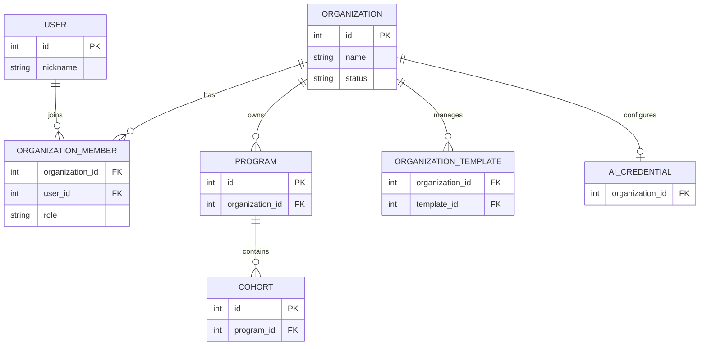
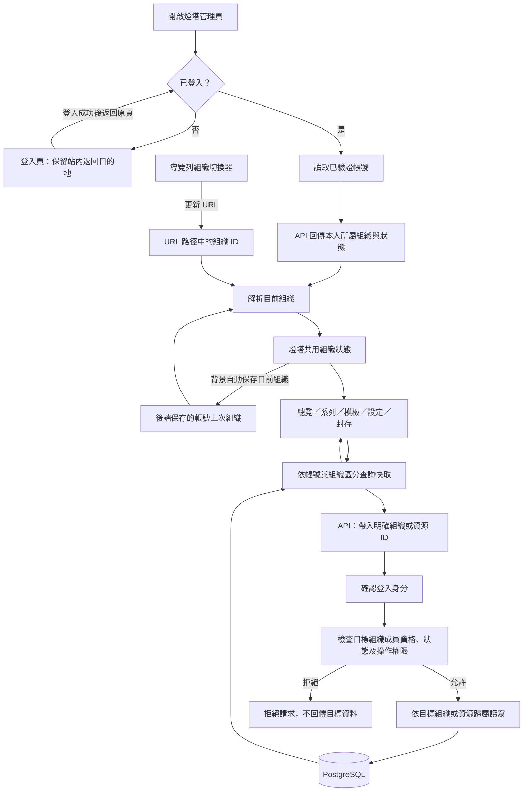
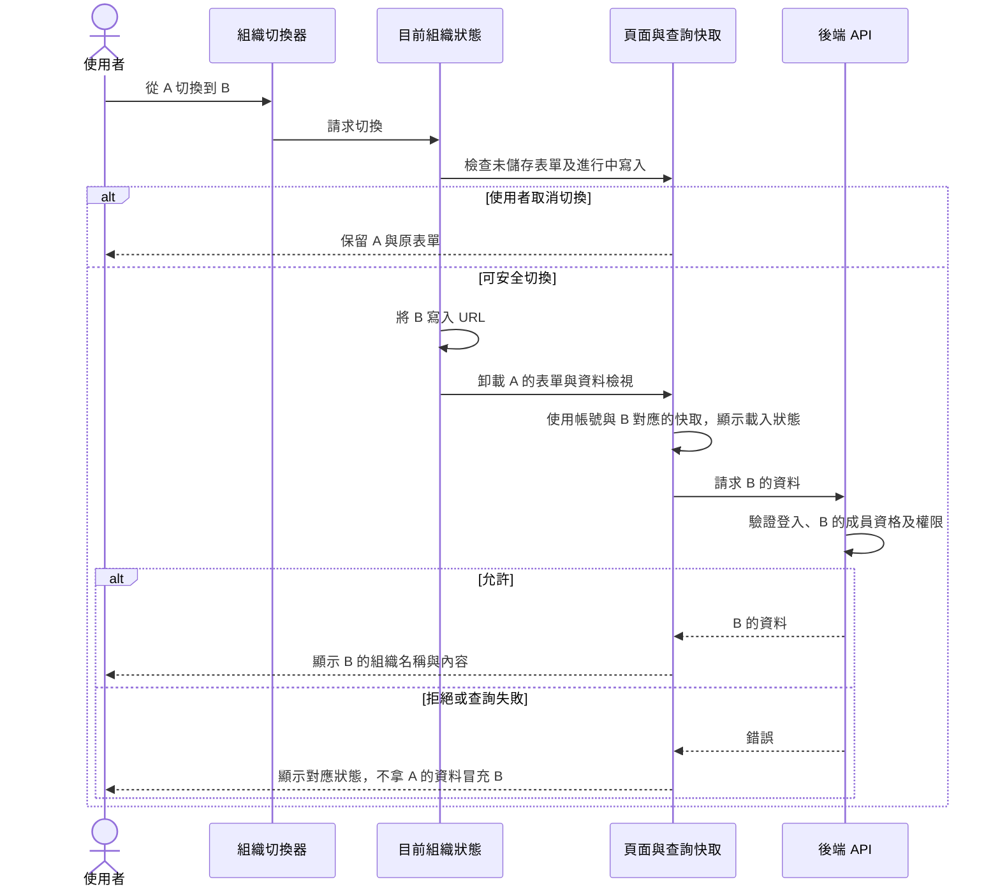
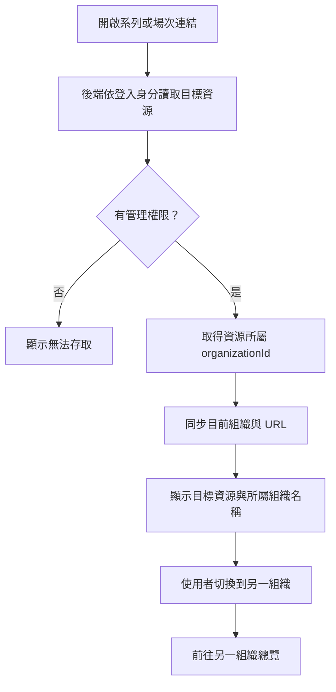

# 燈塔多組織切換架構

日期：2026-10-23  
狀態：架構提案，尚未實作或驗收  
關聯：[#276 Admin 組織設定](https://github.com/daodaoedu/daodao/issues/276)、[#374 第 15 項](https://github.com/daodaoedu/daodao/issues/374)

版本銜接：[#393](https://github.com/daodaoedu/daodao/pull/393) 已合併的文件記錄 query 參數版本在隔離分支完成實作與本機 Chrome 代表旅程驗證，當時尚未合併相關程式、部署或通過整體驗收。本提案改採組織路徑，並新增舊網址導向與重要操作確認條件；上述既有驗證不代表此路徑方案已實作或驗收。

## 1. 目標與核心規則

同一個登入帳號可以加入多個組織。使用者在燈塔選擇「目前組織」後，總覽、系列與場次、模板庫、組織設定、成員與封存應一致顯示該組織的內容。

上次選擇的組織隨帳號保存，下次登入或換裝置時自動恢復。燈塔管理頁沿用現有登入守門（f2e `middleware.ts`：未登入導向登入頁，登入後返回原頁）。燈塔以外私人空間的登入守門與個人進度保存另案處理，見[草稿](../../plans/issue-drafts/private-space-login-guard.md)。

同一組織的成員共同管理該組織；建立另一個組織不會自動建立另一個登入帳號。帳號與組織透過成員關係連接，權限仍由後端逐次檢查。目前成員角色只有 `owner` 一種，同組織成員的權限相同；本提案不新增角色。

本提案補上前台的組織選擇與狀態一致性。平台管理後台的全組織管理、官方共同挑戰的歸屬規則，以及學員加入場次的資格維持各自的流程。

## 2. 帳號與資料關係



此圖表達概念關係，並非新增資料表的 migration 規格。`ORGANIZATION_TEMPLATE` 表示組織管理模板的關係；平台內建模板可能依既有規則共用，不代表每份模板都必須由單一組織獨占。場次內的學員資格也不由組織成員關係取代。

例：帳號甲加入組織 A、B，帳號乙只加入 A。甲可在 A、B 之間切換；甲與乙選 A 時看到同一組織的資料，符合共同管理的預期。

## 3. 前後端整體架構



切換器只改變「使用者目前要管理哪個組織」，不授予新的權限。即使前端已確認資格，後端仍須從已驗證的登入身分查成員關係，不信任 client 自行宣告的 user ID、角色或 organization ID。

## 4. 目前組織的唯一依據

建議採用 **URL 路徑中的組織 ID 作為一般組織頁目前組織的依據**，前台共用狀態從 URL 與有效成員清單推導。後端依帳號保存上次選擇，供進入未指定組織的入口時自動恢復，包含換裝置後登入的情境。瀏覽器快取只作加速，不能作為唯一保存來源。系列／場次資源頁維持現有網址，以資源實際歸屬決定組織，見第 6 節。

```text
/en/lighthouse/o/2                 總覽
/en/lighthouse/o/2/programs        系列與場次列表
/en/lighthouse/o/2/templates       模板庫
/en/lighthouse/o/2/organization    組織設定
/en/lighthouse/o/2/archive         封存
/en/lighthouse/programs/{programId}/cohorts/{cohortId}/...   場次頁（不變）
```

**為何放路徑而非 query 參數**：

- 現有語系切換為 `router.replace(pathname, { locale })`（`components/layout/sidebar/language-pill-toggle.tsx:18`），只保留路徑、不帶 query；放 `?organizationId=` 會在切語系時遺失。
- 放在路徑時，`[organizationId]` layout 直接取得參數，站內連結由 layout 參數組成，不必每個連結手動補 query。
- 業界常見做法亦同：Clerk 官方指南建議多組織 app 把組織放在路徑（`/orgs/:slug/...`，亦可用組織 ID），並由 middleware 依路徑同步目前組織；Supabase 的組織頁放在組織路徑、專案頁以專案 ID 反查組織，與本提案的組織頁／場次頁分工相同。
- 使用組織 ID 而非 slug：組織目前沒有 slug 欄位，本輪不新增。

舊網址（`/lighthouse`、`/lighthouse/programs`、`/lighthouse/templates`、`/lighthouse/organization`、`/lighthouse/archive`）視為「未指定組織的入口」，由 middleware 依下表規則 redirect 到對應的組織路徑，既有書籤與信件連結不失效。上述 URL 為提案，現有頁面尚未支援。語系切換、導覽及瀏覽器上一頁／下一頁都應保留或恢復對應的組織。

| 進入情境 | 選擇規則 |
|---|---|
| URL 明確指定有效、可管理組織 | 使用 URL 指定值 |
| URL 指定無權限或已停權組織 | 顯示無法管理及返回可用組織的入口，不靜默換成別的組織 |
| 未指定組織，上次選擇仍有效 | 恢復該帳號上次選擇，寫入 URL |
| 未指定組織，沒有有效的上次選擇 | 預設第一個可管理組織，寫入 URL |
| 沒有任何可管理組織 | 顯示無可用組織狀態；區分未開通、組織停權與查詢失敗 |

只有一個可管理組織時，顯示組織名稱即可；有多個時提供切換器。停權組織可以列出並標示不可管理，但不作為自動預設值。這些是本提案建議的產品行為。

後端組織列表（`listForUser`）不篩停權組織，f2e `middleware.ts` 只要列表非空就放行燈塔頁。因此「只剩停權組織」的帳號會進到燈塔頁面，停權狀態須由共用組織狀態判斷並顯示，不能只靠 middleware 擋。

各頁不能再各自讀取 `organizations[0]`。共用狀態負責提供 `currentOrganization`、載入狀態及選擇錯誤；組織資料尚未確認前，不送出該組織的業務讀寫請求。取得本人組織清單、以及經後端授權以確認深層資源歸屬的請求不受此前置條件限制，避免解析組織時循環等待。

### 4.1 在 middleware 補上組織參數

f2e `middleware.ts` 每次進入燈塔頁已呼叫 `/api/v1/lighthouse/organizations`。未指定組織的入口（含上節的舊網址）在此一併讀取帳號上次組織，依上表規則直接 redirect 到 `/lighthouse/o/{organizationId}/...`；頁面因此不會先以「無組織」狀態渲染再換網址，也不多一次請求。場次／系列深層連結不經此 redirect，依第 6 節由頁面以資源歸屬決定。middleware 取得上次組織失敗時不擋頁，退回「第一個可管理組織」規則。

### 4.2 上次組織的寫入規則

| 情境 | 是否寫入上次組織 |
|---|---|
| 使用者在切換器明確切換 | 寫入 |
| 開啟一般組織頁，URL 指定有效、可管理的組織 | 寫入 |
| 深層連結（摘要信、我的空間、場次網址）自動帶出的組織 | 不寫入，避免只是點信看一眼就改掉預設 |
| URL 指定無權限或停權組織 | 不寫入 |

寫入在背景進行，失敗不擋操作也不提示成功，下次符合條件時再寫。讀取時一律重新驗證成員資格與組織狀態，已失效的值視為沒有上次選擇。

### 4.3 登入守門

燈塔管理頁沿用現有 middleware 的登入守門：未登入導向登入頁並保留站內返回路徑，已登入但無組織／資源權限時顯示無權限狀態，不反覆送回登入頁；服務失敗導向 `access-required?reason=unavailable`，不誤當登出。本提案不改變這套行為，只確認切換器與組織參數不破壞它。

## 5. 切換流程與資料一致性



- **表單與寫入**：有未儲存內容時，提醒使用者選擇取消切換或放棄內容；寫入尚在進行時暫停切換。每個送出的操作固定使用提交當下的組織／資源 ID。
- **導航守門**：切換器、站內連結及瀏覽器上一頁／下一頁造成的組織變更，統一經過上述確認與寫入等待流程；取消時保留原組織、表單及 URL。刷新或離站則依瀏覽器支援提供未儲存提示，不承諾瀏覽器一定顯示提示或能攔截關閉；重新載入後以已驗證的 URL 重新建立狀態。
- **快取與延遲回應**：組織查詢的 key 必須包含組織 ID，並隔離不同登入帳號的資料。A 的較晚回應不能覆蓋 B 的畫面；登出或換帳號時清除舊帳號的私有快取。現況已具備大部分：`packages/api` 的組織查詢 key 已含 `organizationId` 參數，登出時清空整個 SWR 快取（`hooks/use-logout-redirect.ts:16-22`）；本輪只需確保新頁面沿用，並以 AC-04 驗收。
- **重要操作的目的地確認**：發訊息給學員、邀請成員等送出後難以撤回的操作，確認畫面再次顯示組織與場次名稱，不只依賴頁首。開啟中的這類視窗在組織切換時關閉，不改綁到新組織後送出。
- **表單重建**：切換組織時重建設定表單、驗證狀態及編輯視窗，避免 uncontrolled input 的 `defaultValue` 留著上一個組織的內容。
- **AI key**：切換後清除尚未送出的 key 輸入及測試結果，重新取得目標組織的設定狀態。前端不保存或回顯已儲存的完整 key。

## 6. 場次與系列的直接連結

場次／系列已有自己的組織歸屬。直接開啟深層連結時，以後端驗證後的資源歸屬決定組織，不能拿上次選擇的組織覆蓋它。

場次頁網址不含組織 ID，因此不會出現「網址寫 A、場次屬 B」的矛盾。開啟場次頁時先由後端檢查使用者能否管理該場次：有權時，目前組織設為場次所屬的 B（不寫入上次組織，見第 4.2 節）；沒有權限時拒絕存取，不改查其他組織的資源。站內導航到此連結仍須先處理原頁未儲存內容。



在 A 的場次頁切到 B 時，前往 B 的總覽，不把 A 的 `programId`／`cohortId` 留在 URL 再搭配 B。

**必要的 API 調整**：現有場次回應（`cohortResponseSchema`）只有 `programId`，沒有 `organizationId`；後端也沒有 `GET /programs/{programId}`，只能依組織列出系列。前端因此無法從場次連結得知所屬組織。本提案定案在 `GET /api/v1/lighthouse/programs/{programId}/cohorts/{cohortId}` 回應加入 `organizationId` 與組織名稱，沿用該端點既有的成員與停權檢查，不另開新端點。

## 7. 與現況的差異及實作範圍

2026-10-23 查核（f2e、server `origin/dev`）發現，前台六個元件直接以 `organizations?.[0]` 選第一個組織：

| 元件 | 位置 |
|---|---|
| `lighthouse-overview` | `apps/product/src/components/lighthouse/lighthouse-overview.tsx:93` |
| `programs-manager` | `apps/product/src/components/lighthouse/programs-manager.tsx:1587` |
| `templates-manager` | `apps/product/src/components/lighthouse/templates-manager.tsx:39` |
| `organization-settings` | `apps/product/src/components/lighthouse/organization-settings.tsx:35` |
| `archive-manager` | `apps/product/src/components/lighthouse/archive-manager.tsx:27` |
| `cohort-focus` | `apps/product/src/components/lighthouse/cohort-focus.tsx:50` |

後端組織列表依本人 membership 篩選，按組織建立時間升序排列。系列、模板、封存、AI key 等端點已在 service 層檢查成員資格與組織停權（例：`program.service.ts` 的 `assertActiveOrganization`、`getOwned`）。資料庫有獨立的組織與成員關係，不能把「看到同一組織」直接判定為資料混用。

dev 已有多組織帳號：user 301 同時屬於組織 2、3（停權）、900001（驗收 fixture）、4（島島阿學）。因前台固定取首筆，此帳號目前只能管理組織 2，無法進入「島島阿學」。多組織情境不需等上線才出現，驗收可直接使用此帳號。

**優先修正 `cohort-focus`**：它把首筆組織 ID 傳給 `CohortMessageComposeDialog`，該對話框用這個 ID 讀取、新增及刪除訊息模板（`cohort-message-dialogs.tsx:127,149,167`）。多組織帳號開啟 B 的場次時，訊息模板會讀寫 A 的資料，屬實際寫錯組織，不只是顯示問題。

| 範圍 | 建議調整 |
|---|---|
| `daodao-f2e` `cohort-focus` | 優先：訊息模板改用場次實際所屬組織（依第 6 節回應欄位） |
| `daodao-f2e` 燈塔共用外框 | 加入目前組織狀態、組織名稱及切換器 |
| 其餘五個直接取首筆的元件 | 改用共用選擇 |
| 查詢、表單及導覽 | 帶入目前組織、隔離快取、處理未儲存內容及深層連結 |
| 燈塔路由 | 一般組織頁移到 `app/[locale]/(lighthouse)/lighthouse/o/[organizationId]/`；場次頁路徑不變；舊網址由 middleware redirect |
| 燈塔站內連結 | 改用共用的連結產生函式，由 layout 的組織參數組成（純邏輯，附測試）；場次頁的返回與編輯連結帶場次實際所屬組織。現有未帶組織的連結見下表 |
| `daodao-server` | 場次 GET 回應加入 `organizationId` 與組織名稱（第 6 節）；新增讀寫帳號上次燈塔組織的 API（例：`GET`／`PUT /api/v1/lighthouse/preferences`，讀取時驗證成員資格與組織狀態），寫入規則見第 4.2 節；發起人快覽的組織名稱規則修正（見下方）；補跨組織 regression tests |
| `daodao-storage` | 新增最小 migration 保存帳號上次的燈塔組織（例：`users` 加可為空、指向組織的欄位，組織刪除時設為空）。已查核無可沿用欄位：`users` 無設定類欄位，`user_preferences` 是推薦用的偏好選項關聯表。上次組織的跨裝置恢復納入本輪 |
| `daodao-f2e` middleware | 未指定組織的入口與舊網址讀取上次組織並 redirect 到組織路徑（第 4.1 節）；登入守門行為不變 |
| 文案 | 切換器、停權、無權限、無可用組織等新狀態補中英文文案，需通過 f2e ICU 文案檢查（#311） |
| `daodao-admin-ui` | 保留平台管理員全組織管理；本輪不在此處實作前台切換器 |

未帶組織的站內連結（`apps/product/src/components/` 下）：

| 位置 | 連結 | 影響 |
|---|---|---|
| `lighthouse/lighthouse-shell.tsx:21-30` | 五個導覽項目 | 切頁後回到預設組織 |
| `layout/sidebar/constant.tsx:54` | 側欄燈塔入口 | 同上（屬未指定組織的入口，依第 4 節恢復上次組織即可） |
| `lighthouse/cohort-shell.tsx:56` | 場次頁返回 `/lighthouse/programs` | 返回到非場次所屬的組織 |
| `lighthouse/cohort-shell.tsx:68`、`lighthouse/lighthouse-overview.tsx:22` | `/lighthouse/programs?edit=<cohortId>` | 系列頁開在別的組織時找不到要編輯的場次 |
| `lighthouse/cohort-outcome-summary.tsx:158` | `/lighthouse/organization` | 開到預設組織的設定 |
| `lighthouse/lighthouse-membership-guard.tsx:51` | `/lighthouse` | 同側欄入口 |

站外進入場次的入口：每週摘要信（server `cohort-weekly-digest.service.ts:66`，指向 `/focus`）與我的空間進管理端（f2e `lib/spaces/space-href.ts:16`）。兩者都是場次深層連結，依第 6 節由 API 回應帶出組織，網址本身不需改。

**連動的公開資訊**：server `activity.service.ts:331-339` 的發起人快覽取 `orgMemberships[0].organization.name`，查詢未排序。多組織發起人在公開頁顯示哪個組織名稱不固定，回應的 `organizationName` 亦同。不屬燈塔管理頁，但源自同一個「單一組織」假設，此外，取名稱的查詢會納入停權組織，也會納入此人不是最早 owner 的組織，與後段計算主辦場次的規則不一致。

快覽目前只在 `/activities` 從某張活動卡點開（f2e `host-preview-dialog.tsx:83-85`，顯示「某組織的發起人」），因此本輪修正為：

- 快覽 API 新增選填的 `cohortId`；活動卡帶入該卡場次，組織名稱取該場次所屬組織，與卡片一致。
- 未帶 `cohortId` 時，只從此人實際主辦、且為 active 的組織中取；恰好一個才顯示，多個則不顯示組織名稱，不任意挑選。
- 沒有暱稱時以組織名稱代替的 `name` 欄位，套用同一規則。

現況證據以上表的原始碼位置為準；燈塔尚未上正式環境，也尚未以多組織帳號在 dev 完成操作驗收。

## 8. 驗收條件

| ID | 情境 | 預期結果 |
|---|---|---|
| AC-01 | 帳號只加入 A | 直接進入 A，清楚顯示組織名稱 |
| AC-02 | 帳號加入 A、B，從 A 切到 B | 各管理頁使用 B 的資料與寫入目標，無 A 的表單或內容殘留 |
| AC-03 | 在 B 切頁、刷新、切語系或使用上一頁 | 依 URL 正確保留或恢復組織 |
| AC-04 | A 的請求較晚回來 | 不覆蓋 B 的畫面；不同帳號快取也不互用 |
| AC-05 | 有未儲存內容或進行中寫入 | 取消切換保留內容；確認放棄才切換；寫入完成前不切換 |
| AC-06 | 只有 A 權限的帳號自行指定 B 或 B 的資源 ID | 後端拒絕讀寫；不回傳 B 的資料 |
| AC-07 | 兩個帳號都加入 A | 兩人都是 owner，可共同管理 A 的同一份資料 |
| AC-08 | 直接開啟有權管理的 B 場次，先前選 A；含從每週摘要信及我的空間點入 | 顯示 B 場次，組織名稱與目前狀態同步為 B |
| AC-09 | 組織停權、成員資格被移除或組織查詢失敗（dev 可用 user 301 指定組織 3） | 顯示對應狀態，不使用舊快取繼續管理或靜默換組織 |
| AC-10 | 從 A 的 AI key 設定切到 B | 清除未提交輸入與測試狀態，僅顯示 B 的設定狀態 |
| AC-11 | 帳號加入 A、B，在 B 的場次頁發訊息 | 訊息模板的列表、新增、刪除都作用在 B，A 的模板不受影響 |
| AC-12 | 帳號在裝置一用切換器選 B，再於裝置二登入並開啟燈塔首頁 | 自動進入 `/lighthouse/o/{B}`，畫面不先閃過其他組織 |
| AC-13 | 未登入直接開啟 `/lighthouse/o/{B}/...` 燈塔管理連結 | 顯示登入頁，不洩露燈塔內容；登入成功後返回原網址（含組織路徑）並檢查權限 |
| AC-14 | 登入失效、已登入無權限或服務故障 | 登入失效才導向登入；其餘顯示對應狀態，不造成登入迴圈 |
| AC-15 | 上次組織寫入失敗或使用者換帳號 | 不擋操作、不假稱保存成功；待處理寫入不得跨帳號執行 |
| AC-18 | 上次選 A，從摘要信開啟 B 的場次後，再直接開啟燈塔首頁 | 仍進入 A；深層連結不改寫上次組織 |
| AC-19 | 開啟舊網址（`/lighthouse`、`/lighthouse/programs` 等）或舊書籤 | redirect 到上次組織（或第一個可管理組織）對應的 `/lighthouse/o/{id}/...` 頁面 |
| AC-20 | 在 B 的場次發訊息給學員或邀請成員 | 確認畫面顯示 B 與場次名稱；確認前切換組織時，視窗關閉且未送出 |
| AC-16 | 在 B 的任一管理頁點導覽、場次返回、編輯場次或成果頁的組織設定連結 | 一律停留在對應的組織（場次相關連結為場次所屬組織），不回到預設組織 |
| AC-17 | 多組織發起人在 A、B 各有公開活動，分別從 A、B 的活動卡點開發起人快覽 | 各自顯示該卡所屬組織名稱；不顯示停權組織；未帶場次且主辦多個組織時不顯示組織名稱 |

## 9. 拆卡與開發順序

以 #374 第 15 項為母卡拆子卡，各 repo 分別 PR：

| 順序 | 子卡 | repo | 依賴 |
|---|---|---|---|
| 1 | `cohort-focus` 訊息模板改用場次所屬組織 | f2e（必要時 server 先補第 6 節欄位） | 第 6 節欄位；不等切換器，可最先上 |
| 2 | 上次組織欄位 migration | storage | 無 |
| 3 | 場次回應加組織欄位、上次組織 API、發起人快覽修正 | server | 2 |
| 4 | 燈塔路由移到組織路徑、共用組織狀態、middleware redirect、連結產生函式、切換器、文案 | f2e | 3 |

第 1 項若需要第 6 節欄位，server 欄位可先單獨上，不必等 migration。各子卡依 dev-task 流程開發；母卡等子卡全部驗收後才關。

純邏輯與後端權限修正須附 regression tests；頁面切換、表單狀態及深層連結以實際操作驗收。合併、部署到 dev 與上述驗收應分別記錄，不能以其中一項代替其他項。
