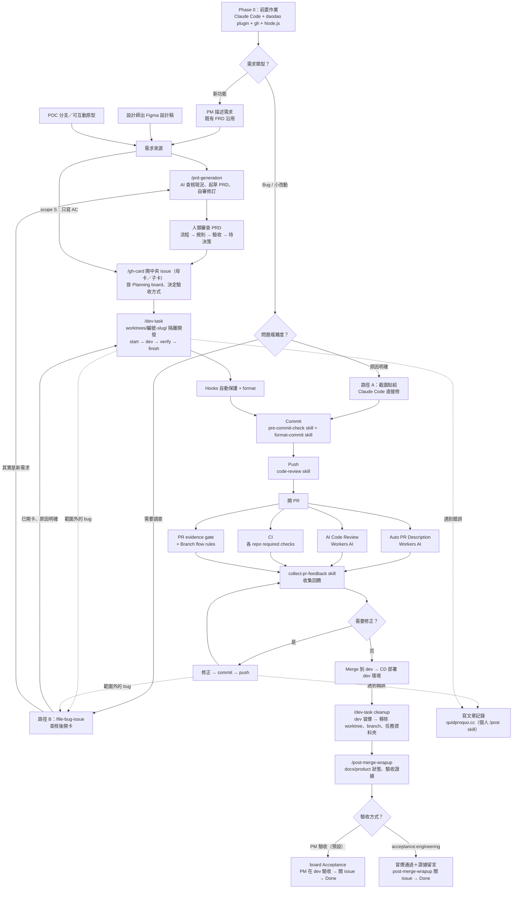

# 島島阿學開發工作流程

> 註（2026-09-20）：OpenSpec 已退役，舊 `openspec/` 封存於 `docs/archive/openspec/`，`/openspec-*` skills 不再使用。規格以 `docs/product/` 的 PRD／FRD 與中央 issue 的驗收契約為準；本文已依此改寫。同日退役自動派工 Routine A／B（#241）與 merge 回寫 Routine C；board 狀態由各 skill 呼叫 `bin/pipeline/board.ts` 寫回，所有開發走人工 `/dev-task`。
>
> 最後全面校正：2026-10-28。逐段對照 `plugin/skills/` 正本、`plugin/hooks/`、monorepo 與各 sub-repo 的 workflow、ruleset 與 package.json；涵蓋到 2026-10-23 merge 的變更（PR #309 dev-task 拆階段、#315 工程驗收、#387 Need Fix 分流與每日 board audit〔issue #338〕、#365 closing keyword 攔截〔issue #364〕、#351／#363／#371／#388／#391 CI review 改版）。各步驟細節以 `plugin/skills/` 正本為準，本文只寫全貌；本文的 `/x` 都是指 `/daodao:x`。

## 簡介

島島阿學（daodao）是一個由多個子專案組成的教育平台，涵蓋前端、後端、AI 服務、資料庫、基礎設施與背景任務。隨著專案規模成長，我們建立了一套從需求到部署的完整工作流程，核心理念是：

1. **規格先行、深淺分級** — PRD／FRD 是需求真相、中央 issue 的驗收契約是執行基準；scope 決定要寫到哪一層（Phase 1.5）
2. **自動化品質守護** — 透過 hooks、CI/CD、AI Code Review 等機制，讓品質檢查發生在每一個環節
3. **人類保有最終決策權** — 自動化處理繁瑣工作，但每個關鍵節點（規格審查、commit 確認、PR merge）都由人類做最終判斷

本文完整記錄這套流程的每一個階段。

---

## 全貌

整個開發流程分為 Phase 0–9，其中 Phase 1.5（規格層級判定）決定一件工作要走多深：



---

## Phase 0：前置作業

在進入開發流程之前，需要先把工具鏈設定好。以下是每位開發者加入時需要完成的環境設定。

### 0.1 AI 輔助開發工具

| 工具 | 用途 | 安裝方式 |
|------|------|---------|
| **Claude Code** | 主力 AI 開發工具，執行 daodao plugin 的 skills 與 hooks | `curl -fsSL https://claude.ai/install.sh \| bash`（原生安裝器） |
| **Codex CLI** | `/daodao:code-review` 四引擎之一；也可當替代客戶端（讀 `.agents/skills/`，hooks 需先 `/hooks` 信任） | `npm install -g @openai/codex` |
| **OMP** | `/daodao:code-review` 四引擎之一（OpenRouter 免費模型） | `bun add -g @oh-my-pi/pi-coding-agent` |
| **OpenCode** | `/daodao:code-review` 四引擎之一（OpenCode Zen 免費模型） | `npm install -g opencode-ai` |

code-review 的引擎缺哪一個就記「未執行」，不會整個失敗；四個都裝 review 覆蓋率最高。

同一套 13 個 skills 在 Claude Code、Codex CLI、ChatGPT 桌面版都能用；ChatGPT 網頁／行動版與 Claude.ai 只收其中 7 個（需求、bug 通報、開卡、PR feedback 等不需本機 checkout 的流程；`dev-task`、`code-review`、`pre-commit-check`、`format-commit`、`post-merge-wrapup`、`gh-pipeline` 不在內）。安裝方式與平台能力落差見 [plugin/README.md](../plugin/README.md)。

### 0.2 GitHub CLI（gh）

整個流程大量依賴 `gh` 指令：開 PR、建 issue、查看 CI 狀態、收集 review feedback、移 Planning board 卡片。

```bash
# macOS
brew install gh

# 登入（移 board 卡片需要 project scope）
gh auth login
gh auth refresh -s project
```

登入後確認可以存取團隊的 repos：

```bash
gh repo list daodaoedu --limit 5
```

### 0.3 開發環境

| 項目 | 版本 / 工具 | 說明 |
|------|------------|------|
| **Node.js** | 20.19.4+ | f2e 以 `.nvmrc` 鎖 20.19.4；server／admin-ui 映像用 Node 20；monorepo root 的 CI 用 Node 22 |
| **pnpm** | 10.15+（f2e／admin-ui 鎖 10.20.0） | monorepo root `pnpm@10.15.1`、f2e／admin-ui `pnpm@10.20.0`；server 的映像仍是 `pnpm@9.1.0` |
| **Python** | 3.12 + uv | daodao-ai-backend 用 `uv` 管依賴（`uv.lock`），映像為 Python 3.12 |
| **Docker** | latest | 本地 DB 與部分子專案開發需要 |
| **Git** | 支援 `git worktree` | `/daodao:dev-task` 以 worktree 隔離每個 issue |
| **jq** | latest | `pre-pr-gate` hook 必需，缺了會直接擋下 `gh pr create` |
| **rclone** | latest | dev-task verify 上傳驗證報告截圖到 Google Drive（一次性設定見 `plugin/skills/dev-task/references/verify-report.md`） |

```bash
# 確認版本
node -v && pnpm -v && python3 --version && uv --version && docker --version && git --version && jq --version && rclone version
```

### 0.4 Claude Code 設定

流程的 skills 與 hooks 都包在 **daodao plugin** 裡，正本在 `plugin/`，由 GitHub release 發布：

1. **安裝 plugin（每人一次）** — 本 repo 的 `.claude/settings.json` 已宣告 marketplace（指向 release、開 `autoUpdate`），在 repo 內開 Claude Code 後跑 `/plugin install daodao@daodao`，重開 session。不在 repo 裡的人先 `claude plugin marketplace add https://github.com/daodaoedu/daodao/releases/latest/download/marketplace.json`
2. **Skills** — 指令帶命名空間：`/daodao:dev-task`、`/daodao:gh-card`……本文寫 `/dev-task` 時都是指 `/daodao:dev-task`（`/code-review` 尤其要注意，Claude Code 另有同名的內建 skill）
3. **Hooks** — 六支，註冊在 `plugin/hooks/hooks.json`，隨 plugin 生效：session-start、pre-write-guard、test-integrity-guard、pre-pr-gate、post-write-format、stop-quality-gate；完整說明見 [Phase 3.3](#33-開發中的自動化hooks)。改了 `plugin/` 正本要等 plugin 發版、更新後才生效
4. **改 plugin 的人** — 用本機 marketplace：`claude plugin marketplace add ./` 再 `claude plugin install daodao@daodao-dev`；正本改完跑 `pnpm plugin:build` 重產各平台產物，產物不手改

裝好後確認：

```bash
claude plugin details daodao@daodao   # 應列出 13 skills 與 hooks
```

### 0.5 MCP Servers

| MCP Server | 用途 | 設定位置 |
|------------|------|---------|
| **daodao-pg-dev／daodao-pg-prod** | 唯讀查詢 dev／prod DB（經 SSH tunnel） | 專案 `.mcp.json`（已宣告）；需在 shell 設 `DAODAO_MCP_DIR`（daodao-mcp clone 的位置）、`DAODAO_PG_DEV_URL`、`DAODAO_PG_PROD_URL`，連線字串向管理者索取，不寫進 repo |
| **notion** | 讀 Notion 舊文件 | 專案 `.mcp.json`（已宣告）；需設 `NOTION_TOKEN` |
| **playwright** | dev-task verify 的瀏覽器驗收（`browser-verify.md` 指定） | 個人自行安裝 |
| **Google Drive** | 下載 POC、建立驗證報告文件 | 個人自行安裝 |
| **Figma** | 有 Figma 連結時用 `get_screenshot` 取設計稿 | 個人自行安裝 |

### 0.6 快速確認清單

設定完成後，確認以下指令都能正常執行：

```bash
# GitHub CLI
gh auth status

# Claude Code 與 plugin
claude --version
claude plugin details daodao@daodao

# monorepo 依賴（board.ts 等腳本用 pnpm -s tsx 執行）
git submodule update --init
pnpm install

# 子專案依賴與品質檢查（以 daodao-f2e 為例；子專案都在 projects/ 下）
cd projects/daodao-f2e && pnpm install
pnpm run lint && pnpm run typecheck
```

全部通過後，就可以從 Phase 1 開始了。

---

## Phase 1：需求輸入

每一個功能的開發都從需求開始。需求分兩類：**新功能開發**走 PRD 定稿 → 開卡 → 隔離開發；**Bug 修復 / 小改動**直接修或先通報。分流依據見 [Phase 1.5](#phase-15規格層級判定)。

### 新功能開發

需求可以從 PM 描述、設計稿、POC 分支三種來源進入，最終都收斂成一份 PRD。這確保所有需求都有文字記錄，不會只存在於某個人的腦中或某次會議的口頭討論裡。

### 1.1 PM 描述需求

最正式的需求來源。提出者用白話描述「誰、在哪個情境、遇到什麼問題、希望怎麼改善」即可，不用填 repo、API、SHA、負責人；由 `/prd-generation` 查核現況、起草、補洞（見 Phase 2）。

**新需求只寫一份 PRD**，功能行為與驗收都在裡面，不再另外要求 FRD；大型需求可以連結子 PRD。**既有 FRD 仍然有效**：沿用原文件、決策與 FR／TP 識別碼，不為了改名重新搬寫。PRD 的驗收情境（TP）之後就是 `/dev-task` verify 階段逐條驗收的清單。

**工程審閱**：PRD／FRD 送工程審閱後常有定案（例如「統一 90 天／3 段／50 字上限」）。定案要回寫 PRD；來不及回寫時，記進中央 issue 的決策區塊，`/dev-task` 的驗收契約以它為準（見 Phase 2）。

### 1.2 設計師出 Figma 設計稿

設計師在 Figma 完成 UI 設計後：

- 截圖放到 `docs/product/<功能>/`，或直接提供 Figma URL
- 開發與驗收時透過 Figma MCP 的 `get_screenshot` 取設計稿對照

### 1.3 在分支開發 Prototype（POC）

有些需求用文字和設計稿很難說清楚，特別是互動體驗或技術可行性。直接在分支上做 prototype（常見是可互動的 HTML 原型），用 code 回答「這樣行不行」。`/prd-generation` 會以唯讀 diff 辨認 POC 展示的行為，記成候選需求：假 API、localStorage、假成功提示不代表正式服務已存在，權限、資料保存、失敗處理仍要在 PRD 補洞。有可互動原型的任務，`/dev-task` verify 會做 POC 並排比對（見 Phase 3）。

### 1.4 放置位置

需求文件按功能模組放在 `docs/product/<功能>/`（目前 30 多個模組，例如 `practice/`、`challenge/`、`lighthouse/`、`notification/`、`social/`、`onboarding/`、`admin/`、`island/`、`space/`）。`/prd-generation` 的草稿先存既有任務目錄，沒有任務目錄時存 `docs/plans/requirements/`（不覆蓋舊檔）；人審核確認後依 PRD 附錄記錄確認基準。`docs/product/` 的功能狀態（已合併／已部署／已驗收）由 `/post-merge-wrapup` 在 merge 後回寫。

### Bug 修復 / 小改動

不是所有工作都需要走 PRD → 開卡。Bug 和小改動有兩條路徑：

**路徑 A：直接修** — 原因明確、範圍小。把截圖、錯誤訊息、重現步驟貼給 Claude Code，修完直接進 Phase 4（commit → PR），不開卡、不寫 spec。PR body 仍要有「## 驗證證據」（或不適用聲明），PR evidence gate 會檢查。

**路徑 B：`/file-bug-issue` 通報** — 原因不明、需要調查，或要交給別人修。通報者只要描述現象、附截圖或 log；skill 自行定位子專案、查核 codebase 與重複卡、起草後交人審閱，依授權開到 `daodaoedu/daodao`。草稿存在任務的 `notes/issue-drafts/`，沒有任務目錄時用 `docs/plans/issue-drafts/`。詳見後面的 [Bug 追蹤](#bug-追蹤)。

`docs/troubleshooting/` 是舊的分析案例存放處（`auth-error/`、`android-oauth-login-fix.md` 等），新的問題不再往這裡放。

查核後原因明確 → 開 S 卡或直接修；發現問題複雜（跨 repo、要改資料模型）→ 當成新功能走 Phase 1.5 判定。確認其實是新需求時，保留原始通報、改走 `/prd-generation`。

---

## Phase 1.5：規格層級判定

這一步決定「要寫多少規格才能開工」。過去的混亂來自於沒有明確規則——有時候寫完整規格、有時候只有 FRD、有時候什麼都沒有就開 issue。現在的規則：

> **PRD／FRD 是需求真相，中央 issue 的驗收契約是執行基準。**

兩份東西各有角色，不是二選一：

| | PRD / FRD | 中央 issue |
|---|---|---|
| 誰寫 | 提出者描述，`/prd-generation` 查核起草、自審修訂，人審核確認 | `/gh-card` 從對話與已定稿 PRD 推斷 |
| 回答什麼 | 要做什麼、為什麼、流程、規則、驗收條件（FR／TP／AC） | 現在做到哪、誰在做、本卡驗收契約（Acceptance snapshot） |
| 位置 | 草稿在任務目錄或 `docs/plans/requirements/`；既有功能文件在 `docs/product/<功能>/` | daodaoedu/daodao issue + Planning board |
| 誰消費 | `/gh-card` 的輸入、`/dev-task` verify 的檢查清單 | `/dev-task` start／finish、`/post-merge-wrapup` 的 board 回寫 |

### 判定表

| scope | 條件 | 規格要求 | 進入方式 |
|---|---|---|---|
| **L / M** | 跨 repo（storage + server + f2e）、改資料模型、有關鍵待確認事項、需求與工程審閱有落差需定案 | **PRD 必須定稿**：含流程、規則、驗收與待決策清單（`/prd-generation`）；工程定案回寫 PRD 或記進 issue 決策區塊；issue body 的 Acceptance snapshot 指向該 PRD 版本 | Phase 2 → Phase 2.5 開卡 → Phase 3 `/dev-task` |
| **S** | 單 repo、工程決策少、範圍明確 | issue body 寫 **Acceptance Criteria** 即可，不必另寫 PRD | Phase 2.5 開卡 → `/dev-task` |
| **XS / bug** | 原因明確的修正、文案、樣式 | 不需要 spec，不需要 issue | 路徑 A 直接修 → Phase 4 |
| **CI / skill / 文件** | 只動 monorepo 自身的 `.github/`、`plugin/`、`bin/`、`docs/` | issue 寫 AC（給自己追蹤），通常掛 `acceptance:engineering` | monorepo 開 branch → PR 到 main（不直接 push main） |

L/M 的新功能開成**母卡＋子卡**：母卡＝一份 PRD，只放目標、AC 總表與子卡清單；子卡＝可單獨驗收的一塊、約一週內做完，開在中央 repo，只有兩層（見 Phase 2.5）。

判斷 L/M 的訊號只要中一個就算：跨 repo、要 migration、有關鍵待確認事項、需求需要工程定案。定案一定要有文字落點——實踐建立流程（#141）的「統一 90 天／3 段／逐段行動同 50 字」定案當時沒回寫需求文件，只留在工程規格裡；現在這類定案回寫 PRD，或至少記進中央 issue 的決策區塊，讓 `/dev-task` 的驗收契約抓得到。

### 自動派工現況

自動派工 Routine A／B 已於 2026-09-20 退役（#241）：OpenSpec 退役後 Routine A 的 spec gate 失去輸入、只會退卡，Routine B 從未穩定跑通。**Ready for Dev 現在只是管理狀態**，不會觸發任何自動化；所有開發走人工 `/dev-task`。舊 prompt 封存於 `docs/archive/automation/`，要恢復自動派工需另開卡重新設計。

---

## Phase 2：PRD 定稿（prd-generation）

L/M 功能在這一步把想法、既有 FRD、POC 或 issue 整理成一份可驗收的 PRD。OpenSpec 的 proposal／design／specs／tasks 四層 artifacts 已於 2026-09-20 退役，舊 change 封存於 `docs/archive/openspec/`；現在只要一份 PRD，流程、規則與驗收都在裡面，既有 FRD 及其 FR／TP ID 沿用，不另寫 FRD。

### 2.1 為什麼需要這一步

FRD 描述「產品要什麼」，工程師需要知道「現況是什麼、要改成什麼、做到哪算完成」。`/prd-generation` 先查 codebase 現況（`product-status-check` 區分已實作、已測試、已部署、實際可用），再對照需求補洞，把工程審閱的定案和待決策事項寫進同一份文件，讓之後每個接手的 session 都有同一份真相。

### 2.2 流程：描述 → AI 查核與起草 → AI 自審修訂 → 人審核 → 更新定稿

| 順序 | 誰 | 做什麼 | 產出 |
|------|-----|--------|------|
| 1 | 提出者 | 用白話描述誰、在哪個情境、遇到什麼問題、希望怎麼改善；不用填 repo、SHA、負責人 | 對話或 issue |
| 2 | AI | 讀來源（PRD／FRD／Issue comments／POC／設計稿），依 `product-status-check` 查 codebase 現況，列出目前行為、期待改動、影響與未知 | 現況查核 |
| 3 | AI | 依 `plugin/templates/requirements-doc.md` 起草或補洞；已有文件就直接補，不另造同義規格 | PRD 草稿 |
| 4 | AI | 依 skill 的「交審前自審」檢核並修訂：來源與現況證據、目標與範圍一致、流程與畫面狀態、規則與例外、設計差異、跨功能影響、需求到驗收的對應、未確認的推論；能由證據修正的先修 | 修訂後草稿 + 精簡檢核摘要 + 待決策清單 |
| 5 | 人 | 審核是否符合原意、做產品取捨；每輪只回一兩個關鍵決策 | 決策 |
| 6 | AI | 依決策更新，重新檢核受影響的規則與驗收條件，再保存確認基準；關鍵決策未定或現況未驗證時標明限制，不宣稱已定稿 | 確認版 PRD（附錄記錄確認基準） |

草稿存既有任務目錄；沒有時存 `docs/plans/requirements/`（首次使用時建立），用不覆蓋舊檔的檔名。更新既有文件時保留決策與變更紀錄。

### 2.3 PRD 應包含什麼

依 `plugin/templates/requirements-doc.md`：

1. **問題與範圍** — 為誰解決什麼、包含／不包含，「不做什麼」也寫清楚
2. **現況與希望改動** — `product-status-check` 查到的目前行為與期待的改變
3. **使用流程與功能規則（FR）** — 操作步驟、每一步的系統行為、欄位限制、權限、例外與錯誤處理；工程審閱定案（例如「90 天／3 段／50 字」）直接寫在這
4. **驗收情境（TP）** — 每條寫前提、操作、預期結果，含反面條件（不顯示什麼、不出現什麼）；這份清單就是 `/dev-task` verify 的檢查清單
5. **待確認與變更** — 分「關鍵待確認」（開工前要定）與「可延後」，加變更紀錄
6. **查核與交接附錄** — 由 skill／開發補充來源、查核證據與確認基準

技術設計（API、資料模型、跨 repo 拆分）不寫進 PRD；由 `/dev-task` start 的 repo 判定與 task.md phases 承接。

### 2.4 人類審查

進入開卡之前，人類審查 PRD：

- **範圍** — 方向對不對？會不會太大或太小？「不做什麼」有沒有寫？
- **規則** — 定案都記進去了嗎？待確認事項有沒有分清楚「開工前要定」與「可延後」？
- **驗收** — edge cases 漏了嗎？反面條件寫了嗎？每條都能實際驗證嗎？
- **現況** — AI 查到的「程式已有但未部署」「文件說規劃中但已上線」有沒有處理？

寧可在這一步多花時間，也不要寫了一半的 code 才發現方向錯了。確認 PRD 不等於 Ready for Dev 或派工。

---

## Phase 2.5：開卡（gh-card）

規格確認後，用 `/gh-card` 在 **daodaoedu/daodao** 開一張中央 issue 並掛上 Planning board。這張卡是之後所有狀態的指標：`/dev-task` 從這裡讀需求並移 In Progress／Review，`/post-merge-wrapup` 冒煙後移 Acceptance（交 PM 驗收）／Need Fix，PM 關 issue 才 Done。

```
/gh-card（從對話推斷欄位，互動確認一次）
  Title    功能名稱（中文，與 board 既有卡片同風格）
  Body     plugin/templates/central-issue.md：任務索引與責任、目標與範圍、
           驗收契約（Acceptance snapshot：PRD／FRD 版本與 FR／TP／AC ID、驗收方式、Done 條件）、
           執行政策與狀態、跨 repo 交付索引
  Labels   scope:XS|S|M|L、repo:<sub-repo>（可多個）、bug／enhancement／documentation、
           acceptance:engineering（工程驗收卡才掛）
  Status   Todo（預設）：發布後 `pnpm -s tsx bin/pipeline/board.ts set <n> todo` 掛板並回讀
```

草稿先存本機（任務目錄的 `notes/issue-drafts/`，沒有任務目錄時用 `docs/plans/issue-drafts/`），預覽後發布；對話中已明確授權建立的，不再重複詢問。開卡前先查既有相關卡，避免重複。

**母卡與子卡**（[GitHub Issue 管理規範 §4](automation/github-issue-management.md#4-母卡子卡pr-與相依關係)）：開新功能（一份 PRD）時，母卡只放目標、AC 總表與子卡清單，並依 AC 一次拆好子卡——子卡開在 `daodaoedu/daodao`（`gh issue create --parent <母卡>`），每張對應母卡的部分 AC、約一週內做完，body 保留 `Parent: daodaoedu/daodao#N` 行。只有兩層；技術債、後續改進開獨立卡寫「相關：#n」，不掛子卡。`/dev-task` 只在子卡或獨立卡開工，不在母卡上開工。單一 repo 的工程交接可用 `subtask-issue.md` 開在 sub-repo，只當交接筆記，不掛 sub-issue、不上 board。

開卡時同時決定**誰驗收**，只問一句：PM 在 dev 環境操作，看得出改前改後的差別嗎？看得出來（畫面改動、使用者感受得到的後端行為、使用者回報的 bug）→ PM 驗收，不掛 label（預設）；看不出來（skill／hook／CI／board 等開發流程、只在 dev 存在的端點、零差異重構）→ 掛 `acceptance:engineering`，理由寫進 body 的「驗收方式」一行；判斷不了就預設 PM。開發中發現判斷錯了，直接加或拔 label。

開發模式只有一種：人工 `/dev-task`。`human-driving` label 由 `/dev-task` start 自動掛上，作為 board 上的人工開工標記。`auto`／`auto:plan-only`／`auto:auto-pr` 等派工 labels 已隨 Routine A／B 退役（#241）不再使用，label 保留不刪。開卡預設 Todo；Ready for Dev 只是管理狀態。

---

## Phase 3：開發（dev-task）

開發不在 `projects/<repo>` 裡做——那裡只當建立 worktree 的來源，保留它目前的分支與工作檔案；就算不在預設分支或有未提交變更，也不擋開工。每個 issue 在 `worktrees/<issue#>-<slug>/` 有自己的隔離資料夾，多個 session 可同時開發不同 issue 互不干擾。

```
daodao/
├── projects/<repo>/              ← worktree 來源，不在這裡開發
└── worktrees/                    ← gitignored
    └── 141-practice-create-flow/
        ├── task.md               ← 任務 manifest：唯一入口，接手先讀
        ├── evidence/             ← verify 階段的截圖與結果
        ├── poc/                  ← 下載到本機的可互動原型（有 POC 時）
        ├── notes/                ← issue／PR body 草稿
        ├── daodao-storage/       ← worktree @ feat/practice-create-flow
        ├── daodao-server/        ← 同名 branch
        └── daodao-f2e/
```

### 3.1 五個階段

`/dev-task` 依使用者輸入判斷進入哪個階段。`SKILL.md` 只做階段路由，每個階段的步驟與完成條件在 `plugin/skills/dev-task/references/phases/<階段>.md`，一次只讀當前階段；接手時依 task.md Status 決定階段（`planning` → start、`implementing` → dev 或 verify、`verified` → finish、`in-review` → 等 merge 後 cleanup）。實跑卡住（登入、toast、寄信、DB、GraphQL 限流）先查 `references/gotchas.md`。

| 說什麼 | 階段 | 做什麼 |
|---|---|---|
| 「開發 issue #141」 | **start** | 讀卡、判定 repo、防撞、建 worktree、寫驗收契約與 task.md |
| 「接手 worktrees/141-…」或已在該資料夾內 | **dev** | 逐 phase 實作、驗證、commit |
| 「驗證」或全部 phase 完成 | **verify** | 對驗收契約總驗收 + 核心旅程矩陣 + 版面探針 + Google 文件報告 |
| 「發 PR」 | **finish** | Deferred items 開卡、rebase、品質檢查、spec audit、code review、過 pre-pr 閘門、開 PR、回寫 issue |
| 「merge 了」「收尾」 | **cleanup** | dev 冒煙 → 移除 worktree／branch／任務資料夾 → 接 post-merge-wrapup |

#### start — 建立任務

1. `gh issue view` 讀中央 issue（body 與留言）：需求、PRD／FRD、POC 連結與 Acceptance snapshot。**只在子卡或獨立卡上開工**；是母卡就改挑子卡，或先依 AC 拆子卡。POC 是 Google Drive 資料夾時下載到任務的 `poc/`
2. **判定涉及哪些 repo**：逐條需求分類（純 UI / API 行為 / 資料欄位）→ grep 程式碼查證（DTO 驗證、schema 欄位），每個 repo 附依據寫進 task.md；`repo:` label 只當參考
3. **防撞**：建 worktree 前 `pnpm -s tsx bin/pipeline/board.ts set <n> wip --add-label human-driving`（board 移 In Progress＋掛人工開工標記）；在 `projects/<repo>` 內 `git worktree list`、`gh pr list --repo daodaoedu/<repo> --base dev --state open` 查同區域的 in-flight 工作，高重疊時先問
4. 每個 repo 從整合分支開 worktree：`git worktree add worktrees/<n>-<slug>/<repo> -b feat/<slug> origin/dev`（所有 repo 同名 branch；fix 用 `fix/`）。daodao-worker、daodao-infra 沒有 `dev`，用 `origin/main`
5. 補 gitignored 檔案：複製 `.env*`（含 `apps/*/`）；裝依賴——repo 自帶 `pnpm-workspace.yaml`（daodao-f2e）直接 `pnpm install`，其他 repo 加 `--ignore-workspace`（否則 monorepo 根的 `pnpm-workspace.yaml` 會讓 install 變 no-op）；裝完 `ls node_modules/.bin` 確認
6. **產出驗收契約**：從已確認的 PRD／既有 FRD 或 issue 展開 task.md 的 `## 驗收契約`，沿用 FR／TP／AC ID，每條附驗證方式與證據欄。**沒有已確認的驗收契約就不開工**；新增的產品行為列待確認，不因「合理推導」自動成為契約
7. 寫 `task.md`：連結、範圍、repo 判定依據、驗收契約、phases（依驗收契約與 repo 順序拆）、Port offset、Status、PR、備註；直接進 dev，不停下來建議換 session

#### dev — 逐 phase 實作

跨 repo 順序固定 **storage（migration）→ server（API）→ ai-backend → f2e**。修改、安裝與 commit 都鎖在自己的任務資料夾；`projects/` 只做唯讀查證。每完成一個 phase 的預設動作序列，不問「要 commit 還是先看效果」：

1. **自行輕量驗證**：UI → 起 dev server 用瀏覽器看（typecheck 過 ≠ 畫面對），有可互動 POC 的 UI phase 這一步就把 POC 開在旁邊跑基本 probe；API → curl；migration / script / skill → 依 `pre-commit-check` 的「變更類型 × 驗證」對照表。沒有「這種改動不用驗」。碰到 form／mutation／controller／DTO 的 phase 要**真的送出一次**：一筆真實輸入成功、一筆 server 會拒絕的輸入失敗且訊息顯示
2. **契約及測試完整性檢查**：依 `references/benchmark-gates.md` 跑適用 repo 的 schema／API signal 與測試完整性檢查
3. **高風險掃描**：跑 `stop-quality-gate.sh` 看逐檔就緒清單與高風險分類（migration / API / auth / env / CI），有標記的在 task.md 記「⚠ 高風險：<分類>」
4. 驗證過 → `/pre-commit-check` → `/format-commit`
5. 更新 `task.md` 的 checkbox 與 Status，直接進下一個 phase；push 已授權時定期 `git push -u origin feat/<slug>`

只有四種情況停下來：全部 phase 完成（進 verify）、碰到 task.md 記載的待決事項且無法繞過、驗證失敗 2 次修不掉、使用者喊停。phase 邊界是繼續點，不是回報暫停點。

#### verify — 總驗收

有 UI 變更（f2e / admin-ui）的任務必須通過；純後端改跑 API 驗證（curl／整合測試）後直接 finish。dev 階段的快篩只看「這個 phase 有沒有壞」，verify 是對完整驗收清單的總驗收，快篩過了不能跳過。

- **逐條驗收**：從 task.md 的驗收契約展開檢查清單，用瀏覽器逐條走過（工具依 `references/browser-verify.md`），含跨 phase 整合、回歸、無障礙、窄螢幕（390px）與反面條件
- **登入牆不是證據**：導到 `/auth/*` 的截圖等於這頁沒驗過（#166）；要登入的頁面走 dev-login 配方。task.md 不得留「需要手動驗證」清單，每項不是驗掉、就是使用者明確豁免並記原因
- **POC 並排比對**（有可互動 HTML 原型時必做）：用 `getComputedStyle` 量測產出差異表，probe 要涵蓋 `poc-probe-checklist` 全部類別，量完再逐組看並排截圖補漏。每條 ❌ 不是修掉，就是列進「### POC 差異決策」交使用者裁決，確認後 task.md 寫 `POC 差異決策已確認`。沒有「設計系統」這個免死金牌
- **版面探針**（UI repo 必做）：對任務碰到的每條 route，在 390／1024／1440 三個寬度跑 `layout-probe.mjs`，量被導離、`scrollWidth > innerWidth` 橫向溢出、出界元素，「### 版面探針」表貼進 task.md；沒碰頁面寫 `版面探針不適用：<原因>`（#233：settings 每頁多 132px，六個月沒人發現）
- **版面 rect 對照**（零視覺差異的 refactor 必做）：`rect-probe.mjs` 改前改後各量一次、`rect-diff.py` 比對（#240 抽 `PageShell` 證明 15 頁零差異）
- **核心旅程矩陣**（有任何寫入路徑就必做）：每條「建立／編輯／刪除／送出」旅程至少一列真實輸入成功、一列 server 拒絕的輸入失敗，「實際」欄要有 HTTP 狀態碼，FE／BE 規則來源寫 `檔案:行號`；前端手寫規則對不到 server 規則就是缺口，先修再驗。沒有寫入路徑寫 `核心旅程不適用：<原因>`。這是 #188「畫面像 POC 但無法建立場次」的直接對策，見 `references/journey-matrix.md`
- **留證據**：截圖存 `evidence/`，命名 `<phase>-<checkpoint>.png`、旅程列 `verify-jNN.png`；task.md 新增「驗證」區塊記通過／失敗／未做 + 矩陣
- **Google 文件驗證報告**（必做）：依 `references/verify-report.md`，rclone 上傳截圖 → 產生 HTML（核心旅程矩陣放最前）→ 建 Google 文件、設知道連結者可看，連結記進 task.md「驗證」區塊第一行。截圖只留在本機或對話裡等於沒發
- 同一項失敗 2 次 → 停止重複嘗試，整理已查核的原因與證據
- 全部通過（沒有 `- [ ]` 未勾項、沒有「需要手動驗證」清單、版面探針全 ✅）→ Status `verified`

#### finish — 發 PR

前置：task.md Status = `verified`。

0. **Deferred items 先開卡再發 PR**：task.md「## Deferred items」每項要有 issue `#n` 或 `（待開卡：<原因>）`，依 `publish-tasks` 開卡。本卡範圍內沒做完的開子 issue——本任務是子卡時掛到**它的母卡**（只有兩層），是獨立卡時掛本任務；範圍外的後續改進開獨立 issue（寫「#n 的後續改進」），不掛子卡關係，否則母卡永遠關不掉。task.md 在 cleanup 會被刪，只留在 comment 的「之後再做」等於消失（#171 → #188 的第二個根因）

對每個有變更的 repo：

1. `git status` 確認全部 commit；`git fetch origin dev && git rebase origin/dev`（衝突時列出檔案；openapi 生成物用官方腳本重產）
2. `typecheck && lint && test`；既有紅測試用 origin/dev 乾淨 worktree 對照確認非本任務造成
3. **Clean-context spec audit**：`scripts/build-spec-audit.py` 產 audit pack（diff、驗收契約、已確認決策、適用 REVIEW.md），spawn 不帶開發對話的獨立 subagent 逐 FR／TP／AC 標 PASS / FAIL / UNCERTAIN；FAIL 先修
4. `/code-review`（四引擎＋誤判知識庫，見 Phase 5）；需要 force push 時先問
5. push → `gh pr create --base dev --body-file …`（worker、infra 的 base 是 `main`）；body 一律用 `--body-file`。跨 repo 時各 PR body 互相引用並標 merge 順序。**所有 PR（含 daodao root 自己的）用獨立一行 `Refs daodaoedu/daodao#<n>`，不用 `Closes`／`Fixes`／`Resolves`**——closing keyword 會在 PR merge 時就關掉中央卡、board 跟著 Done，跳過 dev 冒煙與 PM 驗收；跨 repo 時其他 repo 的 PR 還沒合就被當完成（#190：f2e 先合、server 懸置一週；#333、#335、#337 也因此被提前關閉）。CI 的 `pr-evidence-gate` 會偵測這類寫法（#364）
6. PR body 要有「## 驗證證據」：驗證報告連結＋核心旅程矩陣（或 `核心旅程不適用：<原因>`）；body 沿用 Why／How 格式。有「## 驗證證據」時 Auto PR Description 會跳過，不覆寫
7. task.md Status → `in-review`，記 PR 連結；`board.ts set <n> review` 移卡
8. **回寫 issue**：`gh issue comment` 列 PR、驗證報告連結、核心旅程摘要、「尚未在 dev 冒煙」、Known incomplete scope；之後用 `/collect-pr-feedback` 收回饋

**pre-pr 閘門**（`plugin/hooks/pre-pr-gate.sh`，攔 `gh pr create`；只在 `worktrees/<task>/` 內有 task.md 時生效（交付閘門設為 block 時，缺 task.md 也會擋），缺 `jq` 時直接擋下；Codex 未信任 hooks 時由 agent 主動做同等檢查）：

| 閘門 | 擋什麼 |
|---|---|
| `pr-status-not-verified` | task.md Status 為空或仍是 planning／implementing |
| `pr-poc-compare-missing` | UI repo 有可互動原型，卻缺比對報告（`notes/poc-compare/report.md`、「### POC 比對」、probe 類別）或差異決策確認行 |
| `pr-journey-matrix-missing` | 核心旅程矩陣缺、沒有錯誤路徑列、或有 ⬜／❌ |
| `pr-deferred-unlinked` | Deferred item 沒子 issue 也沒「待開卡」 |
| `pr-body-evidence-missing` | PR body 缺「## 驗證證據」（報告連結或不適用聲明） |
| `pr-fe-pattern-invalid` | 前端手寫 HTML `pattern` 編不過（#188 根因） |
| `pr-verify-unchecked` | 「## 驗證」有 `- [ ]` 未勾項目或「需要手動驗證」清單（#166：登入牆截圖當證據） |
| `pr-layout-probe-missing` | UI repo 缺「### 版面探針」表或表裡有 ❌（#233：settings 每頁多 132px） |

逃生口 `DEV_TASK_SKIP_GATE="<原因>"`（相容舊名 `DEV_TASK_SKIP_POC_GATE`），只作用於上面八道，一律留痕到 gate ledger。另有試行中的交付紀錄閘門（`DEV_TASK_DELIVERY_GATE_MODE`，預設 off）。完整規則與升級策略見 `plugin/hooks/ADR-0001-gates-over-guidelines.md`。

#### cleanup — merge 後收尾

1. 確認**所有 repo** 的 PR merged（跨 repo 少一支就不算）
2. **dev 冒煙，通過前不刪任務資料夾**：等 CD run 跑到該 revision，用 task.md 的核心旅程矩陣在 dev 環境重跑全部正常列 + 至少一列錯誤路徑，「dev 冒煙」表回寫 issue comment；失敗走 `file-bug-issue` 並標「已合併，dev 冒煙未過」。merge ≠ 可用（#179、#190 都是在 dev 撞到的）
3. `git worktree remove`、`git branch -d feat/<slug>`、`rm -rf worktrees/<n>-<slug>`（矩陣與冒煙結果已在 comment 才刪；clone 模式先確認沒有未 push 的 commit）
4. 接 `/post-merge-wrapup`：更新 `docs/product` 功能狀態，依冒煙結果移卡（見 Phase 8）；`Done` 只由驗收通過產生，這裡不提前移
5. `ls worktrees/` 掃其他已 merge 未收尾的任務

### 3.2 平行開發約定

- 一個 issue 一個資料夾一個 session；2–3 個平行是甜蜜點
- M/L 任務（有中途決策點）→ 獨立 session；XS/S（scope 明確、無決策點）→ 可整包委派一個 subagent 從 start 做到 finish；需要使用者中途點頭的工作不要塞進背景 subagent
- 任務內部的機械子步驟（repo 查證、掃 caller、批次改檔、寫測試）隨時 fan out subagent
- 需要同時跑 dev server 的任務：後開的設 port offset 或用 clone 模式
- DB / docker 全機共享，migration 類任務一次只做一個
- issue 之間有依賴：B 的 worktree 從 A 的分支開，PR base 先設 A，A merge 後再 rebase 回 dev
- rebase 只在「發 PR 前」和「輪到自己 merge 前有 conflict」兩個時機做

### 3.3 開發中的自動化（Hooks）

六支 hook 註冊在 `plugin/hooks/hooks.json`，透過 `.claude/settings.json` 啟用的 daodao plugin 生效（從 release 安裝、自動更新；改 hook 要等 plugin 發版）：

| 時機 | Hook | 做了什麼 |
|------|------|---------|
| Session 開始 | `session-start.sh` | 印出工作區位置、`worktrees/` 進行中任務與 Status、只剩紀錄的任務資料夾、`projects/` 是否偏離各 repo 預設分支或有未提交變更、當日 gate 統計、卡住超過 24 小時的共用設定同步 PR |
| AI 寫入檔案**前** | `pre-write-guard.sh` | 攔截敏感檔案（.env、.pem、.key）與憑證洩漏、保護已存在的 migration 檔、依 frontend／backend profile 套用 block／warn 規則 |
| AI 寫入檔案**前** | `test-integrity-guard.py` | 攔截測試檔新加的 `.skip`／`.only`／`.todo`／`xit`／`fit`／`pytest.mark.skip`／`xfail` 等標記，避免用關測試換綠燈；刪除測試或斷言由 CI `test-integrity.yml` 檢查 |
| 執行 `gh pr create` **前** | `pre-pr-gate.sh` | 發 PR 閘門（見 Phase 3 finish） |
| AI 寫入檔案**後** | `post-write-format.sh` | 依檔案所屬 repo 自動格式化——JS/TS 用 Biome 或 ESLint，Python 用 Black + Ruff；repo 沒有對應設定就不動 |
| 任務結束（Stop） | `stop-quality-gate.sh` | 列出已變更檔案的就緒狀態、diff 統計與高風險分類（migration / API / auth / env / CI） |

閘門事件一律寫進 gate ledger，`analyze-ledger.sh` 可彙整；設計原則見 `plugin/hooks/ADR-0001-gates-over-guidelines.md`。

另有試行中的交付檢查（#301）：`check-agent-delivery.py` 核對 agent-handoff.json、實際 git diff 與證據檔，寫入 trace 由獨立收集器記錄；`pnpm agent:check` 跑這組檢查的回歸測試與範例。新 delivery gate **預設 off**，不攔既有任務；說明見 [development-skills-and-workflow.md](development-skills-and-workflow.md) 與 [agent-learning-loop.md](automation/agent-learning-loop.md)。

### 3.4 各專案品質指令

| 子專案 | 定位 | lint | typecheck | test | 自動修復 |
|--------|------|------|-----------|------|---------|
| daodao-f2e | Next.js 前端＋Expo App | `pnpm run lint` | `pnpm run typecheck` | `pnpm test` | `pnpm run check:fix` |
| daodao-server | Express 後端 | `pnpm run lint` | `pnpm run typecheck` | `pnpm test` | `pnpm run lint:fix` |
| daodao-storage | DB schema / migration | —（`make quality_checks` 會直接改寫檔案，pylint 不回傳失敗） | `make check-schema`（CHECK constraint 一致性） | `make migrate-sql-dev`（對 pg-dev 實跑，重跑確認冪等） | `make quality_checks`（isort＋black） |
| daodao-ai-backend | FastAPI AI 服務 | `make check`（black --check＋ruff；`make lint` 的 pylint／bandit 不會回傳失敗） | — | `make test` | `make format` |
| daodao-worker | Cloudflare Workers | — | `pnpm run typecheck` | `pnpm test` | — |
| daodao-admin-ui | 管理後台 UI | `pnpm run lint` | `pnpm run typecheck` | `pnpm test` | `pnpm run check:fix` |

server 的 `pnpm dev` 或 jest 載入 app 時會重寫 `openapi.json`／`openapi.yaml`，而 origin/dev 的排序和產生器輸出不同，會冒出十幾萬行 diff。commit 前用 `git checkout origin/dev -- openapi.json openapi.yaml` 還原，只 commit `generated/openapi-types.ts`；重產留給獨立 chore PR（見 `references/gotchas.md`）。

---

## Phase 4：Commit

寫完 code 之後，不是直接 `git commit` 就好。我們有一套兩步驟的 commit 流程，確保每次 commit 都是乾淨的。

### 4.1 Pre-commit 檢查

依 AGENTS.md 的 commit 流程，AI 在 commit 前執行 `pre-commit-check` skill（不是 git hook，要由流程呼叫；寫檔當下的自動格式化另由 `post-write-format` hook 負責）：

0. **判斷指令入口** — 依 repo 用 Makefile、pnpm 或 monorepo root 的指令
1. **格式檢查與自動修復** — `make check`／`pnpm format:check`，有錯先 `make format`／`pnpm format` 再重查
2. **靜態分析** — lint；TS 專案加跑 typecheck
3. **變更對應的驗證，沒跑過不准 commit** — 依變更類型對照：程式改動跑相關測試、workflow 跑 YAML parse、shell 跑 `bash -n`、migration 實跑並重跑確認冪等、UI 開瀏覽器快篩、文件抽查路徑與連結
4. **回報** — 修不了的由 AI 先定位原因並附修正建議，只有產品取捨才交人決定

這一步確保進到 commit 的 code 至少通過基本的品質門檻。

### 4.2 產生 Commit Message

通過 pre-commit 檢查後，`format-commit` skill **先起草、一次給你確認**，不逐項發問：

1. **讀完整 diff** — `git diff --staged` 的內容（不只 stat），type、scope、Why、How 都從這裡和對話脈絡推導
2. **i18n 健康檢查** — 只在 staged 變更含 UI 原始檔或 locale 檔時執行
3. **起草 Why／How** — Why 從對話與 issue 推斷為什麼要改，How 從 diff 歸納具體做法
4. **展示一次、確認後 commit** — 以 `git commit -F` 提交，提交前核對 staged 範圍沒有夾帶別人的變更；只有理由真的推斷不出來時才發問

最終產出的格式：

```
<type>(<scope>): 簡短描述

## Why is this necessary?

- 原因 1
- 原因 2

## How does it address?

- 做法 1（自動從 diff 推導）
- 做法 2
```

為什麼要這麼做？因為好的 commit message 是給未來的自己和隊友看的。三個月後你看到一個 commit，「Why」告訴你為什麼當時要改，「How」告訴你具體改了什麼。這比 `fix bug` 或 `update code` 有用太多了。

---

## Phase 5：Push 前 Code Review

commit 完成後、push 到遠端之前，還有一道本地 review。

### 5.1 流程

`code-review` skill 會審查整個 branch 相對於 base branch 的所有變更。`SKILL.md` 只放前置步驟，引擎指令在 `references/engines.md`、整合與查證在 `references/findings.md`：

```
git push 前
  → Claude 問「要 review 嗎？」
    → Yes → code-review skill 審查整個 branch
      步驟 0   建共用 review input：base 的 REVIEW.md 審查準則 + diff + Context Pack + <known_false_positives>（誤判知識庫）
      步驟 1   確認 base 與變更範圍
      步驟 2–5 Codex / OMP（OpenRouter free）/ OpenCode（Zen free）/ Claude Sonnet 5.5 四引擎獨立 review
               前三者有 fallback 模型鏈，Claude 固定 claude-sonnet-5-5；缺少的引擎記為未執行，不宣稱四引擎都過
      步驟 6.5 OMP／OpenCode／Claude 的表格套 filter（C 類自承看不到 → drop；D 類假設性 → 降 Low），
               再跑 verify（A 類「找不到 X」在 head tree 查到反證 → 移出，並列出命中位置供覆核）；
               Codex 是自由文字，由 AI 逐項比對
      步驟 7   cross-model 分析（幾個引擎共同回報）
      步驟 8   AI 逐條用程式碼證據查證，分成 已確認缺陷／待產品決策／證據不足／誤判
               有修復授權才修（bug 先補 regression test），否則給修正建議
      步驟 8.5 查證為誤判的 → review-knowledge.cjs record --source local（工具缺失時記在本機報告）
      → commit／push 依既有授權，不因 review 完成自動執行
    → No → 直接 git push
```

### 5.2 檢查項目

四個引擎都以 base 的 `REVIEW.md` 為審查基準。Codex 與 Claude 看下面四個面向；OMP 與 OpenCode 只回報可直接證明的邏輯與安全缺陷，不報風格或假設性問題：

1. **邏輯錯誤** — 條件判斷是否正確？迴圈會不會無窮？null/undefined 有沒有處理？
2. **安全問題** — 有沒有 SQL injection、XSS、敏感資料洩漏的風險？
3. **效能問題** — N+1 query？不必要的 re-render？大量資料沒有分頁？
4. **架構一致性** — 是否符合各專案的 project-rules？命名慣例對不對？有沒有用錯 pattern？

這一步的價值是在 code 離開本機之前就抓到明顯問題，減少 PR 上的來回修正。

### 5.3 誤判知識庫（與 CI 共用）

本機四引擎與 CI 都會誤判——2026-08-29 首批 24 筆紀錄中 16 筆來自 CI、8 筆來自本機，到 2026-10 已累計 170 多筆。查證的功不能只留在對話裡，所以本機 review 與 CI review 共用一份紀錄：

| | 位置 |
|---|---|
| 紀錄 | `.github/review-knowledge/false-positives.jsonl`（monorepo 單一來源，sync 派發唯讀副本到各 sub-repo） |
| 腳本 | `.github/scripts/review-knowledge.cjs` — `prompt-block`（彙整已知樣態餵模型）、`filter`（確定性過濾）、`verify`（A 類 absent-claim 到 head tree `git grep` 查反證）、`record --db auto`（從任何 worktree 往上找 monorepo 寫回）、`test`（每筆 `sample`+`expected` 當 fixture） |
| 樣態 | A absent-claim（對 diff 外程式碼做「找不到／缺少」斷言）、B deletion、C unverifiable、D hypothetical、E format、F misattribution — 定義與對策見 [.github/review-knowledge/README.md](../.github/review-knowledge/README.md) |

兩條鐵律：**查證為誤判的 finding 要 `record`**；**改 `UNVERIFIABLE_RE`／`HYPOTHETICAL_RE`（或 verify 的 `ABSENT_*_RE`）必附 `--sample` + `--expected`**，`review-knowledge.cjs test` 要綠。紀錄先留在本機；依授權 commit＋push 到 monorepo main 後，`sync-claude-config` 會對各 sub-repo 開同步 PR，required checks 過了才 auto-merge——是否已派發要看該次 workflow。

知識庫解不了的（A 類過半、記錄靠人、關鍵字過濾脆弱）在 [docs/automation/review-false-positive-research.md](automation/review-false-positive-research.md) 有文獻對照與落地順序（#168 Context Pack 補脈絡、#169 verify 後置查證，兩者都已上線）。

---

## Phase 6：開 PR

Push 到遠端並開 PR 後，GitHub Actions 會自動觸發下列檢查：

### 6.1 自動化檢查

```
PR opened / updated
  ├── 1. Auto PR Description — 自動產生 PR 標題和描述（dev-task 開的 PR 會跳過）
  ├── 2. AI Code Review — Cloudflare Workers AI 審查 diff
  ├── 3. CI — 各 repo 自己的 lint／typecheck／test（見 6.4）
  ├── 4. PR evidence gate — 讀 PR body「## 驗證證據」，並攔指向中央 issue 的 closing keyword
  └── 5. Branch flow rules — 檢查 branch 命名與允許的 base（sub-repo 為 branch-base-check；root 由 branch-guard 負責）
```

1、2、4、5 的 workflow 正本在 monorepo，由 `sync-claude-config` 同步到各 sub-repo（f2e、server、ai-backend、storage、worker、admin-ui、infra、mcp）。CI 通常 2–5 分鐘跑完；AI review 有 25 分鐘 job 上限。

**PR evidence gate** 是本機 `pre-pr-gate.sh` 的 CI 版，涵蓋 Codex／手動 gh 開的 PR，但只看 PR body：驗證報告連結＋核心旅程矩陣（或「核心旅程不適用」），以及 closing keyword（#364，不吃分支前綴、`evidence-exempt` 或 bot 豁免）；本機那八道閘門它不重做。模式由 repo variable `PR_EVIDENCE_GATE_MODE` 決定：**f2e、server 是 `block`，而且列為 dev 分支的 required check**；root 與其他 repo 未設定＝`warn`，只出警告。

**monorepo root 另有**：`test-integrity`、`pack-regression`、`scorer-regression`、`regression`（main 的 required checks）。**f2e 另有**第三方檢查：SonarCloud、Vercel、CodeQL、GitGuardian。

### 6.2 Auto PR Description

| 項目 | 說明 |
|------|------|
| 觸發時機 | PR opened；body 已有「## 驗證證據」（dev-task 開的 PR）、`auto/*` 分支、`[auto]` 開頭標題或掛 `code-review` label 時跳過 |
| 引擎 | Cloudflare Workers AI（GLM 4.7 Flash，Gemma 4 26B fallback） |
| 效果 | 根據最多 50 筆 commit subject 產生繁體中文的 Why / How 描述，**覆寫整個標題與 body** |
| 設定檔 | `.github/workflows/auto-pr-description.yml`（monorepo 單一來源，sync 派發） |

需要在 GitHub Actions secrets 設定 `CLOUDFLARE_WORKERS_AI_ACCOUNT_ID` 與 `CLOUDFLARE_WORKERS_AI_API_TOKEN`；缺 secrets 時只出警告並跳過。

它是給手動開、沒寫內文的 PR 一個起點；走 dev-task 的 PR 自己寫 body（Why／How＋驗證證據），不會被覆寫。

### 6.3 AI Code Review

| 項目 | 說明 |
|------|------|
| 觸發時機 | PR opened / synchronize / reopened / ready_for_review；draft 與 shared-config sync PR 跳過模型呼叫；synchronize 只審 diff 有變的檔（#368） |
| 引擎 | Cloudflare Workers AI（Gemma 4 26B，GPT-OSS 120B fallback） |
| 效果 | 有限分批提供完整 diff 與 BEFORE／HEAD source，搭配 Context Pack，產生來源可核對的 finding 與明確 coverage report |
| 設定檔 | `.github/workflows/code-review.yml`（monorepo 單一來源，sync 派發） |

流程（runtime、policy、context retriever 與知識庫從事件 **base SHA** 載入；Python isolated mode 避免 PR 模組被載入。Workflow 本身的修改仍需 review）：

```
Plan            immutable merge-base..head；每批 40k bytes、最多 24 批、總 source 800k bytes；放不下先降級脈絡（complete → before-hunks → head-only → hunks），最後才列未審查
Incremental     synchronize 時讀上次 review 留言內的基準，PR diff 沒變的檔沿用上次結果（rebase／update-branch 不呼叫模型）；掛 `ai-review:full` 後 re-run job（或下次 push）才全審
Coverage        每個 changed path 入 manifest；產物／binary／超預算等明列未審查，不截前綴
Context Pack    retrieve-context.sh：route middleware / DTO schema / 刪檔替代者（#168）+ caller / importer / 同模式 ⚠ / in-flight PR
Known FP        review-knowledge.cjs prompt-block 提供歷史脈絡；不再以 Markdown filter 刪列後轉成 clean
Workers AI      Gemma 4 26B → 每批最多一次 GPT-OSS 120B fallback；429／5xx 重試兩次，連續 2 批全失敗即停，15 分鐘時間上限
Strict validate JSON、finish reason、exact path 回執、HEAD／BEFORE side、行號與來源引用；不猜行號、不修補模型格式
Verify          review-knowledge.cjs verify：A 類「找不到 X」在 head tree 查到反證時，只在留言末尾加標註（不刪 finding）
Report          完整 artifact + status.json；失敗／漏檔案／限制必呈現 Review 未完成
Check           `AI review coverage`：complete → success、partial → neutral（warn 模式）、0 檔被審 → job 失敗
Post            同 head PATCH、新 head POST；超長報告只縮公開留言，完整報告留 artifact
```

首次導入時若可信 base 尚無 runtime，必明列 `trusted_runtime_missing`，由本機／人工審核承接；正常合併後後續 PR 才採用。Job 綠燈是流程執行成功且至少審到部分檔案，審查是否完整看 `AI review coverage` check 或 `status.json.complete`；`AI Code Review` 不是 required check，不擋 merge。Workers AI 免費額度每日 10k neurons，用完會整批 429，只能等 00:00 UTC 重置後 re-run。完整設計、primary sources 與限制見 [complete-ci-review.md](automation/complete-ci-review.md)。

嚴重度依 base 的 `REVIEW.md`（CI 把它當 policy 傳給模型）：

| 嚴重度 | 含義 | 處理方式 |
|--------|------|---------|
| P0 | 可證明的資料外洩、重大資料損毀或全面不可用 | 阻擋交付 |
| P1 | 主要功能錯誤、權限繞過、破壞相容性、必要需求不符合 | 修正並重驗後才交付 |
| P2 | 有具體影響的局部問題 | 說明觸發條件、範圍與修法後處理 |
| P3 | 非必要改善建議 | 與必修分開，不因此擴張需求 |

CI 模型只輸出 P1–P3，而且只回報有證據的「新引入 regression」，不負責風格建議（未使用的 import、命名之類不在範圍）。它會誤判也會漏報，所以 finding 一律先查證再處理。

**對誤判的回覆方式**：在 PR 上回 `/fp <第幾條> <A-F> <一句為什麼>`（例：`/fp 1 A route 已掛 authenticate，引用行號指到別的函式`），`collect-pr-feedback` 只採 PR 作者或已驗證成員的回覆，查證後收割進誤判知識庫（見 5.3）。紀錄合併進 monorepo main 並同步後，之後的 review 才會在 `<known_false_positives>` 看到這個樣態（CI 從 PR 的 base SHA 讀知識庫）。

**Debug**：先看 job summary、head 對應的 coverage 留言與 `ai-review-<pr>-<head>` artifact 中的 manifest／status.json。模型輸出無效或未覆蓋部分會列出原因；沒有留言時另查 posting step 的權限與 API 錯誤，不能把 job success 視為完整審查。

### 6.4 CI 品質檢查

各專案的 CI workflow 會自動跑對應的品質檢查（PR base 是 `dev`；worker、infra 是 `main`）：

| 子專案 | CI 內容 | Workflow 檔案 | Required checks |
|--------|---------|--------------|-----------------|
| daodao-f2e | workflow-tests → typecheck + lint + test（不 build）；mobile 另跑 typecheck + lint + EAS 設定檢查 | `linode-ci.yml`、`mobile-ci.yml` | `TypeScript & Lint Check`、`test`、`workflow-tests`、`PR evidence（驗證報告 + 核心旅程）` |
| daodao-server | `types:generate`（Prisma／OpenAPI）→ typecheck + lint + jest（含 Postgres service，不 build）；PR 與每晚比對 SQL ↔ Prisma schema | `continuous-integration.yml`、`schema-drift.yml` | `test`、`workflow-tests`、`Compare SQL ↔ Prisma schemas`、`PR evidence（驗證報告 + 核心旅程）` |
| daodao-ai-backend | unit test → black／ruff 檢查（bandit 只提示） | `ci.yml` | `Unit Tests`、`Format & Lint` |
| daodao-storage | 基本查詢＋schema SQL 驗證；migration upgrade／reapply／constraints；改到 `schema/**`、`migrate/sql/**` 時跑 schema 同步檢查 | `ci-postgres.yml`、`migration-regression.yml`、`schema-sync-check.yml`（`acceptance-fixture-health.yml` 只排程跑） | `Migration Upgrade & Constraints`、`PostgreSQL CI Test` |
| daodao-worker | test + typecheck | `ci.yml` | `TypeCheck` |
| daodao-admin-ui | test + lint + typecheck | `ci.yml` | `Continuous Integration` |
| daodao-infra | nginx 設定驗證與拒絕規則 regression | `nginx-validation.yml` | `Nginx configuration and gate regression` |

CI 是最後一道客觀防線：各 repo ruleset 的 required checks 全綠才能 merge。`AI Code Review`、`AI review coverage`、`Branch flow rules` 不是 required check。

### 6.5 收集 PR Feedback

CI 和 AI review 跑完後，用 `collect-pr-feedback` skill 一次收集所有回饋：

```
使用者說「收集 feedback」或「看 PR review」
  → collect-pr-feedback skill
    1. 確認 PR、head SHA；讀 CI 狀態（gh pr checks）與失敗 job log
    2. 收集 AI Code Review、SonarCloud／Vercel（f2e）與人類 reviewer 的 comment，去重同一根因
    3. AI 逐條對程式碼／測試查證：已確認缺陷／待產品決策／證據不足／已解決或不適用
       - 人類要求與模型 High 都只是待查證訊號，多個模型同意也不等於正確
       - `/fp <n> <A-F> <why>` 只採 PR 作者或已驗證成員的回覆，查證後 record --source ci（不自動 commit／push）
    4. 有修復授權：修已確認缺陷（bug 先補 regression test）→ 走 pre-commit-check／format-commit commit；
       push 與回覆 reviewer 需另有授權
       只有分析授權：給修正建議與驗證方法，不擅改程式
    5. 交人審核：已修什麼、還有什麼待決策
```

這個 skill 解決的問題是：一個 PR 上可能有來自 AI review、bot 與人類 reviewer 的十幾條 comment，手動一條一條看很耗時。skill 先把查證與授權範圍內的修正做完，你只需要審結果與做產品決策。

---

## Phase 7：Merge & Deploy

### 7.1 Merge 條件

一個 PR 要 merge 需要滿足：

- 目標 repo ruleset 的 required checks 全綠（各 repo 不同，見 6.4；f2e、server 含 `PR evidence`）
- AI Code Review 的 P1 已查證處理（AI review 不是 required check，coverage 不完整時由本機 `/code-review` 補）
- 人類 reviewer 審過（流程要求；GitHub ruleset 目前不強制 approve 數）
- **跨 repo 依 PR body 標的順序合併**（storage → server → ai-backend → f2e），不要先合前端；前端一合就會打尚未部署的 API

### 7.2 部署

PR merge 到 `dev` 後，CD 自動部署到 **dev 環境**，`/post-merge-wrapup` 的 dev 冒煙就在這裡做。**prod 不會因為 merge 到 dev 而部署**：要另外把變更合進各 repo 的 prod 分支，分支名稱各 repo 不同。

| 子專案 | 部署方式 | dev 環境（`dev` 分支） | prod 環境（分支） |
|--------|---------|---------|------|
| daodao-f2e（web） | GitHub Actions build Docker image → Linode 主機拉取啟動 | `dev.daodao.so`、`app-dev.daodao.so` | `daodao.so`、`app.daodao.so`（`prod`） |
| daodao-f2e（mobile） | EAS Update OTA，push `dev` 時推到 `preview` channel（測試 app） | 測試 app | 正式版手動 `eas build`／`submit` |
| daodao-server | 同上（Docker image → Linode） | `server-dev.daodao.so` | `server.daodao.so`（`production`；push `main` 仍會建 `prod_app` 容器，但 nginx 沒有導流到它） |
| daodao-ai-backend | SSH 到 Linode 拉程式碼，在主機上 `make up-<env>` build | `ai-dev.daodao.so` | `ai.daodao.so`（`main`） |
| daodao-storage | SSH 執行 `make migrate-sql-<env>`；dev 部署前先備份 prod DB | pg-dev | pg-prod（`main`） |
| daodao-admin-ui | Docker image → Linode 主機拉取啟動 | `admin-dev.daodao.so` | `admin.daodao.so`（`main`） |
| daodao-infra | push `main` 且改到 `nginx/**` 時，SSH `git pull`＋`docker restart nginx` | — | Nginx on Linode（`main`） |
| daodao-worker | **沒有 CD**，手動 `npm run deploy:preview`／`deploy:production`（wrangler） | `worker-dev.daodao.so` | `worker.daodao.so` |

dev 環境 merge 後自動部署；prod、worker、正式版 App 需要另開 PR 或手動操作。f2e、server、ai-backend、storage 的部署結果會發到 Discord；admin-ui、infra 只看 Actions run 狀態。f2e 與 server 另有 emergency rebuild workflow，部署壞掉時手動觸發。

---

## Phase 8：收尾與歸檔

merge 不是終點。少了收尾，worktree 會堆積、`docs/product` 的狀態標示會腐爛（文件寫「規劃中」但功能早已上線）、中央卡永遠停在 In Progress。

### 8.1 `/dev-task` cleanup

PR 全部 merged 後，在任務資料夾的 session 說「merge 了」：

1. 確認所有 repo 的 PR merged（`gh pr view`）
2. **dev 冒煙**（通過前不刪任務資料夾）：CD 跑到該 revision 後，用核心旅程矩陣在 dev 重跑全部正常列＋至少一列錯誤路徑，結果回寫 issue comment；失敗走 `file-bug-issue` 並標「已合併，dev 冒煙未過」，沒過不往下
3. 每個 repo：`git worktree remove`、`git branch -d feat/<slug>`、`git fetch origin dev`（只更新 origin/dev，不動 `projects/` 的本機分支）
4. `rm -rf worktrees/<n>-<slug>`（矩陣與冒煙結果已在 issue comment 才刪；task.md 其他值得留的內容先摘要進 comment；clone 模式先確認沒有未 push 的 commit）
5. 接 `/post-merge-wrapup`
6. `ls worktrees/` 掃其他已 merge 未收尾的任務

`human-driving` label 不在 cleanup 拔，等卡片到 Done 後由 post-merge-wrapup 拔（`board.ts audit` 會列出 Done 仍掛著的卡）。

### 8.2 `/post-merge-wrapup`

1. 核對合併範圍與證據：程式實作／測試／部署／目標環境操作各自要有證據；未執行就記未驗證
2. 目標環境冒煙（同 8.1 步驟 2），表格格式 `## 🔥 dev 冒煙（<環境>，revision <sha>，<日期>）`。跨 repo 要所有 PR 都 merged 且冒煙過才移卡；全部 ✅ 只能在 docs/product 標「dev 冒煙通過，待 PM 驗收」，PM 關 issue 後才標「已驗收」
3. 更新 `docs/product/<功能>/` 的狀態標示（已合併／已測試／已部署／已驗收，附日期與 PR／run）——不可跳過，這是根治「文件說規劃中、程式碼已上線」的關鍵；沒有部署證據不寫已上線
4. 校準地圖：結構、入口或 build 變更 → 更新該子專案的 `codebase-map` skill；服務依賴或 schema 流程變更 → 更新 `system-map`（在各 sub-repo 的 `.claude/skills/`，infra 沒有）
5. 用既有開發文件與 issue 驗收契約記錄完成與剩餘事項；OpenSpec 已退役，不再歸檔 change（舊的封存於 `docs/archive/openspec/`）
6. **移卡＋交接**：冒煙全 ✅ → `board.ts set <n> accept`（移 Acceptance＋assign PM），接著寫好並發「交給 PM 驗收」交接留言（`plugin/templates/issue-status-comment.md`）；冒煙失敗或未冒煙 → `needfix`；母卡還有子卡沒關就留 Review。掛 `acceptance:engineering` 的卡冒煙全 ✅ 時不進 Acceptance，發「工程驗收通過」留言（冒煙表＋驗證報告）後直接關 issue

**交接留言的 PM 步驟只寫畫面上做得到、看得到的操作與預期**。API 送出內容／回讀、regression test、CI、log 放「工程證據（已驗，PM 不需重做）」區塊；只能用 API 或測試驗的 AC 標「工程驗收項」，不列入 PM 步驟（#370、#358：PM 照契約去要 PUT body 與測試輸出，判 BLOCKED 退回）。留言先寫成檔案，發布前跑 `pnpm -s tsx bin/pipeline/acceptance-lint.ts <留言檔>`，有 error 改到通過再發。

### 8.3 Board 與 issue

board 七欄由流程各步驟寫回（`bin/pipeline/board.ts set`）：`/dev-task` start → In Progress、finish → Review（merged 後仍留 Review）、`/post-merge-wrapup` 冒煙通過 → Acceptance（assign PM＋交接留言 @PM）、失敗或未冒煙 → Need Fix；`/collect-pr-feedback` 也可能移 Need Fix；PM 驗收通過關 issue → Done（內建 `Item closed → Done`），AC 沒過 → Need Fix；工程驗收卡冒煙通過由 post-merge-wrapup 關 issue → Done。沒有移卡 cron；PR 一律用 `Refs` 不用 `Closes` 關中央卡（見 Phase 3 finish），內建 workflow 也認不到 `Refs`。七欄語意見 [gh-pipeline skill](../plugin/skills/gh-pipeline/SKILL.md)。

```
單張卡（子卡，或沒有子卡的卡）
Todo → In Progress → Review → Acceptance → Done
                       │   │      │   │
                       │   │      │   ├─ AC 沒過 → Need Fix → In Progress
                       │   │      │   └─ 測不了 → 留 Acceptance + acceptance:blocked
                       │   │      └─ （acceptance:engineering 卡不經過這欄）
                       │   └─ acceptance:engineering 冒煙通過 → 關 issue → Done
                       └─ dev 冒煙失敗 → Need Fix

母卡（有 sub-issues）
子卡各自走上面流程 ─────┐
                        ├→ 子卡全關 → 母卡進 Acceptance → PM 整體走一遍 → 關母卡 → Done
母卡自己的 PR 全 merged ┘
```

| 欄位 | 球在誰手上 | 誰移卡 |
|---|---|---|
| Todo | PM（排優先順序） | `/gh-card` |
| Ready for Dev | 工程師 | 人工（選用的管理狀態，不觸發任何自動化） |
| In Progress | 工程師 | `/dev-task` start |
| Review | 人類 reviewer（review／merge） | `/dev-task` finish；merged 後仍留這裡 |
| Acceptance | PM（`peggy1213-create`） | `/post-merge-wrapup` 冒煙通過：`board.ts` assign PM，skill 另發交接留言 @PM |
| Done | — | PM 驗收通過關 issue，自動移；工程驗收卡由 `/post-merge-wrapup` 關 |
| Need Fix | 工程師 | 冒煙失敗，或 PM 退回且寫出哪條 AC 失敗＋看到什麼 |

- **Definition of Done**：AC 全部符合＋已部署到 dev＋驗收通過。預設 PM 驗收；`acceptance:engineering` 卡以 dev 冒煙通過＋證據留言為驗收。
- **PM 驗收**：每天看「PM 驗收」view（依母卡分組、顯示子卡進度），照交接留言在 dev 操作；通過就關 issue；AC 沒過就留言**哪條 AC 失敗、看到什麼**並移 Need Fix。SLE 2 個工作天，欄位不設上限。
- **母卡／子卡定義**：母卡＝一個功能（PRD），只放目標與子卡清單、不直接掛 PR；子卡＝可單獨驗收的一塊，開在中央 repo、只有兩層；技術債與後續改進開獨立卡。見 [GitHub Issue 管理規範 §4](automation/github-issue-management.md#4-母卡子卡pr-與相依關係)。
- **母卡**：還有子卡沒關（含 bug 子卡）就留 Review，不交 PM、不可先關；PM 驗母卡時看整體串起來能不能用，不重驗子卡 AC。`board.ts audit` 會列出「母卡已 close 仍有子卡未關」與「母卡在 Acceptance 但子卡未全關」。

**Need Fix 只收 AC 失敗**（#338；2026-10-14 板上 17 張 Need Fix 只有 7 張是 AC 真的失敗）：

| 驗收時遇到 | 卡片去哪 |
|---|---|
| 某條 AC 沒過 | `Need Fix`，留言寫哪條 AC 失敗＋看到什麼；沒寫的退回不算數 |
| 測不了（網址被擋、截圖傳不上、帳號權限進不去） | 留 `Acceptance`，掛 `acceptance:blocked` 並 @ 工程；排除後拔 label、@PM 重驗 |
| 驗收當下的新要求、通過後才改文案 | 原卡依原 AC 判定，新要求另開卡（內文寫「相關：#n」，不掛子卡） |
| 同一個 bug 出現在多張卡 | 指向一張卡追蹤，其餘留言連結 |

**每日 board audit**：`.github/workflows/board-audit.yml` 每天台北 09:00 跑 `board.ts audit`（只讀、不移卡；可 `gh workflow run board-audit.yml` 手動跑），結果寫進同一張固定的報告 issue（label `board-audit`）：有落差就更新並保持 open，沒落差就更新成 ✅ 並關閉。抓的落差除了狀態不一致、母子卡、殘留 label，還包括 Need Fix 超過 24 小時沒有 AC 失敗留言、`acceptance:blocked` 超過 48 小時、誤進 Acceptance 的工程驗收卡。這張報告 issue 不放 board、不走驗收。

驗收若發現與 PRD／FRD 有落差 → 回到 Phase 1.5 判定：小落差開 S 卡直接修，大落差用 `/prd-generation` 重新定稿再開卡。

---

## Bug 追蹤

使用者遇到操作異常，或開發／CI 過程中遇到無法立即修復的錯誤時，使用 `/file-bug-issue` skill 整理成 bug 草稿、查核後開成 GitHub issue，避免遺忘或阻塞其他工作。

### 流程

```
遇到操作異常、截圖、對話或 CI 錯誤
  → /file-bug-issue
    1. 先從已有資訊整理草稿：現象、重現步驟、預期與實際、截圖／log；最多問 1–2 個關鍵問題
    2. skill 自行查核現況與重複卡、判定 repo 與可能根因——不問通報者 repo、SHA、負責人、根因
    3. AI 自審修訂 → 人審核草稿
    4. 展示標題、內容、目標 repo 與 labels，依授權用 gh issue create 發布（預設 daodaoedu/daodao）
```

非工程人員也可以直接通報，不需要先知道問題在哪個 repo；無法重現也可以通報，寫明發生頻率與已知條件。草稿存在任務的 `notes/issue-drafts/`，沒有任務目錄時用 `docs/plans/issue-drafts/`。確認其實是新需求時，保留原始通報、改走 `/prd-generation`。

### 適合使用的情境

- **CI 持續失敗** — 分析出根因但需要多方配合修復
- **環境問題** — Docker、雲端、第三方服務相關的問題
- **跨專案 bug** — 需要其他子專案配合修改
- **非緊急但需追蹤** — 不阻塞當前開發，但不能遺忘
- **使用者回報的操作異常** — 截圖或一句描述即可，由 skill 補齊查核

---

## 錯誤記錄與知識分享

開發過程中遇到值得記錄的錯誤、踩坑經驗、或解決方案時，可以寫成技術文章發佈到 [quidproquo.cc](https://quidproquo.cc/)。`/post` 是個人 skill，**不在 daodao plugin 裡**，沒裝的人就自己寫。

### 適合記錄的情境

- **難以 debug 的錯誤** — 花了超過 30 分鐘才找到的 root cause
- **框架/套件的坑** — 文件沒寫、行為不如預期、版本相容問題
- **CI/CD 配置踩雷** — Docker、GitHub Actions、Cloudflare Workers 的各種陷阱
- **跨專案整合問題** — 前後端介接、API 規格不一致、資料同步問題

### 識別化處理

因為是公司專案，**發文前要自己移除**專案名稱、內部 URL、API key、帳號、業務邏輯細節等敏感資訊（skill 不會自動處理），只保留通用的技術問題和解法。目的是讓文章對任何遇到相同問題的開發者都有參考價值。

---

## 工具總覽

以下是整個工作流程中使用到的所有工具，按階段整理：

| 階段 | 工具 | 用途 |
|------|------|------|
| **前置** | Claude Code + daodao plugin | 主力 AI 開發工具；plugin 提供 13 個 skills 與 6 支 hooks（`/daodao:<skill>`） |
| **前置** | Codex CLI／OMP／OpenCode | code-review 的另外三個引擎；Codex 也可當替代客戶端（讀 `.agents/skills/`） |
| **前置** | GitHub CLI（gh） | PR、issue、CI 狀態、Planning board 操作 |
| **前置** | MCP：playwright、Google Drive、Figma、daodao-pg-dev／prod | 瀏覽器驗收、驗證報告、設計稿、唯讀查 DB |
| **需求** | PRD（既有 FRD 沿用） | 一份文件含功能行為與驗收（FR／TP） |
| **需求** | Figma + Figma MCP | UI 設計稿與 `get_screenshot` 對照 |
| **規格** | prd-generation + product-status-check skills | 描述 → AI 查核現況與起草 PRD → 自審修訂 → 人審核 → 確認（L/M 必要；OpenSpec 已退役） |
| **開卡** | gh-card skill | 中央 issue（母卡／子卡）+ Planning board（共用模板、Acceptance snapshot、驗收方式） |
| **開發** | dev-task skill | issue 隔離 worktree（start → dev → verify → finish → cleanup）；projects/ 只當 worktree 來源 |
| **開發** | hooks（六支） | session 狀態注入、寫檔保護與格式化、測試完整性、發 PR 閘門、Stop 品質清單 |
| **品質** | Biome / ESLint / Black + Ruff | Lint + Format |
| **品質** | TypeScript / Pylint | 型別檢查 / 靜態分析 |
| **品質** | Jest / Vitest / pytest | 測試 |
| **Commit** | pre-commit-check skill | Commit 前格式、lint、typecheck 與變更對應的驗證 |
| **Commit** | format-commit skill | 結構化 commit message（Why / How），起草後確認一次 |
| **Review** | code-review skill | Push 前本地 code review（Codex／OMP／OpenCode／Claude Sonnet 5.5 四引擎） |
| **Review** | review-knowledge.cjs + false-positives.jsonl | 誤判知識庫：本機 skill 與 CI 共用的紀錄、prompt 提示、確定性過濾、verify、fixture |
| **PR** | Auto PR Description | Workers AI 為手動開的 PR 產生描述 |
| **PR** | AI Code Review | Workers AI 審查 diff（增量、coverage check） |
| **PR** | PR evidence gate／Branch flow rules | 驗證證據與 closing keyword 檢查；branch 命名與 base 檢查 |
| **PR** | collect-pr-feedback skill | 收集 CI 與 review 回饋，AI 查證、分類，依授權修正 |
| **CI** | GitHub Actions | 各 repo 的 required checks（見 6.4） |
| **CD** | GitHub Actions + Docker／EAS | merge 到 dev 自動部署 dev 環境；prod 另合 prod 分支；worker 手動 wrangler |
| **同步** | sync-claude-config workflow | 共用 workflow 與誤判知識庫從 daodao repo 同步到子專案；sync PR 在目標 repo required checks 全綠後自動 squash merge，紅燈留給人 |
| **發版** | plugin-release workflow | 打包 daodao plugin、建 GitHub release；Claude Code 端自動更新 |
| **收尾** | post-merge-wrapup skill | 核對合併／部署證據、dev 冒煙、更新 docs/product 狀態、交 PM 驗收或關工程驗收卡 |
| **收尾** | `bin/pipeline/acceptance-lint.ts` | 交 PM 驗收留言發布前檢查：PM 步驟不得混入 API／測試證據 |
| **收尾** | notify-related-issue skill | 依實際 PR 與驗收狀態草擬關聯 issue 更新，明確授權才留言或關閉 |
| **收尾** | product-status-drift workflow | 每週一檢查 docs/product 狀態標示與實際落差，發到 Discord |
| **board** | gh-pipeline skill + `bin/pipeline/board.ts` | 七欄語意；`board.ts set／remove／audit`，各 skill 自己移卡；`audit` 每日 09:00 由 `board-audit.yml` 排程跑（只讀）；Routine A／B／C 已於 2026-09-20 退役，見 Phase 9 |
| **拆卡** | publish-tasks skill | 把已確認計畫的未完成任務批次開成子 issue（可驗收子卡開在中央 repo；sub-repo 只放工程交接筆記），人工發布，不觸發自動化 |
| **Bug 追蹤** | file-bug-issue skill | 操作異常或無法立即修復的錯誤整理成草稿，查核後開成 GitHub issue |
| **記錄** | /post（個人 skill）→ quidproquo.cc | 踩坑經驗記錄與知識分享 |

---

## Phase 9：自動化 Pipeline（已退役）

Phase 1–8 是「人類觸發、AI 執行」。Phase 9 原本把 **Ready for Dev 之後**的工作交給三個排程 routine；2026-09-20 起全部退役：Routine A／B（#241）因 OpenSpec 退役失去輸入、從未穩定跑通；Routine C 只認 `auto` label PR，259 次 run 抽樣 60 次全是 no-op，還每小時吃共用 PAT 額度（稽核見 [docs/plans/actions-audit-2026-09-20.md](plans/actions-audit-2026-09-20.md)）。

> 退役文件見 [docs/archive/automation/](archive/automation/README.md)；現行 board 操作見 [gh-pipeline skill](../plugin/skills/gh-pipeline/SKILL.md)。

### 9.1 Routine 清單

| Routine | 載體 | 狀態 |
|---|---|---|
| **A** Board → Dispatch | GitHub Actions script（`bin/pipeline/dispatch.ts`） | **已退役**：OpenSpec 退役後 spec gate 失去輸入；程式與 workflow 已刪除 |
| **B** Dispatch + PR Patrol | Claude cloud routine | **已退役**：依賴 Routine A 的鏡像 issue，從未穩定跑通 |
| **C** Merge → Done | GitHub Actions script（`bin/pipeline/board-sync.ts`） | **已退役**：輸入為零、全是 no-op；由 skill 呼叫 `bin/pipeline/board.ts` 取代 |

### 9.2 人類在流程裡的位置

```
寫 PRD（/prd-generation 定稿）→ /gh-card 開卡（board Todo）
        ↓ 人工確認規格 OK
   Status → Ready for Dev            ← 管理狀態，選用
        ↓ /dev-task start（board In Progress + human-driving、開 worktree）
   人工／AI 協作實作 → verify → 發 PR（board Review）
        ↓ 人工
   review + merge                    ← 品質最後把關；卡留 Review
        ↓ /post-merge-wrapup dev 冒煙
   ✅ board Acceptance（交 PM）／❌ board Need Fix → 下次 /dev-task start 移回 In Progress
        ↓ PM 在 dev 驗收                ← 產品最後把關
   ✅ PM 關 issue → Done／❌ AC 沒過 → Need Fix
   （acceptance:engineering 卡：冒煙 ✅ 後由 post-merge-wrapup 關 issue → Done）
```

### 9.3 手動版

`/publish-tasks` 把已確認計畫的未完成任務（沿用 FR／TP／AC ID）批次開成子 issue（可驗收的子卡開在中央 repo，sub-repo 只放工程交接筆記），先檢核與預覽，依授權才發布；發布後仍由人工 `/dev-task` 開工，不會有任何 routine 接手。

### 9.4 限制

| 限制 | 應對 |
|---|---|
| 沒有自動派工 | 要恢復需另開卡重新設計（不再讀 OpenSpec，改讀 issue 驗收契約） |
| 高風險 repo（storage、infra） | migration／IaC 由人工 `/dev-task` 做 |
| 複雜設計決策 | 留在 Phase 2 由人類定案，寫進 PRD 或中央 issue 決策區塊 |
| 同一區域多人並行 | `/dev-task` start 的防撞檢查 + `human-driving` |

---

## 結語

這套流程不是一天建立的，是隨著團隊踩過的坑逐步演化而來。它的核心價值在於：

- **減少認知負擔** — 不用記住每一步該做什麼，流程和工具會引導你
- **品質內建** — 品質檢查不是事後補做，而是嵌入在每一個環節裡
- **知識留存** — 從 PRD 到 commit message 到技術文章，每一個決策都有文字紀錄
- **AI 執行、人把關** — AI 查核、實作、驗證、冒煙與移卡；人類負責需求定案、review／merge 與 PM 驗收。自動派工試過後退役（Phase 9），現在刻意保留這三個人的關卡

流程是活的，會持續根據實際使用經驗調整。如果你發現某個環節卡住或不合理，那就是改進的機會。
